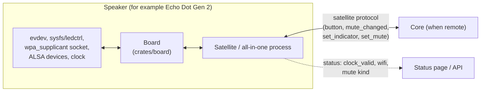

# Board support

Status: Draft (design only, no code yet). Decision record: [ADR-0012](../adr/0012-board-support-layer.md). Requirements: [spec 0001 §4.10](../specs/0001-product-requirements.md). Evidence: [R-07](../research/07-echo-dot-gen2-hardware.md).

A **board** exposes a speaker's physical features to the core: buttons, LED ring, microphone mute, Wi-Fi, a clock check and the names of its audio devices. It is a library used by whichever process runs on the device (the all-in-one binary, or a remote satellite). The satellite protocol is unchanged.

## Where it sits



| Concern | Carried by | Why |
|---|---|---|
| Button presses, mute, indicator, volume | Existing protocol events and commands (REQ-SAT-006/007) | Already on the wire |
| LED state names, gesture mapping | Board file | Per-device data |
| Wi-Fi status/join, clock trust | Local status of the device process | Not wire concepts; the join is an administrator action on that device |
| Audio device names and formats | Board description read by the satellite | Keeps device paths out of the satellite |

## Interface

All areas are optional; the board reports which it has (REQ-BRD-002). Names are descriptive, not final.

| Area | Operation | Dot 2 behaviour |
|---|---|---|
| Capabilities | `capabilities()` | `buttons`, `led(12, rgb)`, `mute(software)`, `wifi`, `clock(unverified-capable)`, `audio`, `takeover` |
| Events | bounded stream: `Button`, `MuteChanged`, `WifiChanged` | threads reading `/dev/input/event1` and `event2` |
| LEDs | `set_state(LedState)`, `set_brightness(0..100)` | `ledctrl -s/-u/-c/-b` |
| Mute | `mute_state()`, optional `set_mute()` | key 113 plus `amz_privacy/state`; no `set_mute` (privacy driver semantics unknown) |
| Wi-Fi | `wifi_status()`, `wifi_join()` | supplicant control socket / `wpa_cli`; `dhcpcd` unchanged |
| Clock | `clock_status()`, optional `set_clock()` | `unset` before 2023-11-14 (TMR-009 floor); otherwise `unverified` until a sync proof |
| Audio | `audio_devices()` | capture `pcmC0D24c`, playback `pcmC0D23p` |
| Takeover | `prepare()`, `restore()` | stop listed services, restore on exit |

Logical LED states (REQ-BRD-006): `idle`, `wake`, `listening`, `thinking`, `speaking`, `muted`, `error`, `offline`, `timer`, `alarm`, `inbox`, `volume`.

Gestures (REQ-BRD-007): `press`, `long_press`, `double_press`, with thresholds in the board file. Actions: `volume_up`, `volume_down`, `mute_toggle`, `action`, `stop`.

## Board file sketch: `boards/echo-dot2.json`

> **Superseded 2026-11-09 by the schema.** The format is now defined by [`schemas/board/board-1.schema.json`](../../schemas/board/board-1.schema.json) and spec [0006](../specs/0006-device-layer-contract.md) (REQ-DEV-008); the real example files are in [`boards/`](../../boards/). Key names changed (`button` is `buttons` with a `source`; `gesture` is `gestures`; `actions` and `states` are as below; `forbidden` stays under `takeover`). The sketch below is kept for the `verify` notes that follow it.

Illustrative; the key names and values are proposals until the board is built. Pattern names are real files in `/system/etc/led-resources/`; key codes and nodes are from the kernel capability bitmaps and Amazon's `acebutton_config.json`. Items marked `verify` need a real button press (R-07 unknown 1).

```json
{
  "board": "echo-dot2",
  "schema": 1,
  "detect": {
    "i2c_name": {
      "path": "/sys/bus/i2c/devices/0-003f/name",
      "equals": "is31fl3236"
    }
  },
  "button": [
    {
      "node": "/dev/input/event2",
      "code": 115,
      "name": "volume_up"
    },
    {
      "node": "/dev/input/event2",
      "code": 114,
      "name": "volume_down"
    },
    {
      "node": "/dev/input/event1",
      "code": 138,
      "name": "action"
    },
    {
      "node": "/dev/input/event1",
      "code": 113,
      "name": "mute"
    }
  ],
  "gesture": {
    "long_press_ms": 700,
    "double_press_ms": 350
  },
  "actions": {
    "volume_up.press": "volume_up",
    "volume_up.long_press": "volume_up",
    "volume_down.press": "volume_down",
    "action.press": "action",
    "action.long_press": "stop",
    "mute.press": "mute_toggle"
  },
  "led": {
    "driver": "ledctrl",
    "count": 12,
    "unset_before_set": true,
    "states": {
      "idle": "",
      "wake": "active-start",
      "listening": "active-on",
      "thinking": "active-thinking",
      "speaking": "active-talking",
      "muted": "mics-off_on",
      "error": "error",
      "offline": "setup-mode",
      "timer": "ready-timer",
      "alarm": "ready-alarm",
      "inbox": "notice",
      "volume": "volume_step-{nn}"
    }
  },
  "mute": {
    "kind": "software",
    "state_file": "/sys/devices/soc/10010000.keypad/amz_privacy/state"
  },
  "wifi": {
    "control_dir": "/data/misc/wifi/sockets",
    "interface": "wlan0"
  },
  "clock": {
    "floor": "2023-11-14",
    "prefer_verified_by": "https-date"
  },
  "audio": {
    "capture": {
      "device": "/dev/snd/pcmC0D24c",
      "card": 0,
      "device_number": 24,
      "rate": 16000,
      "format": "S24_3LE",
      "channels": 9,
      "mic_channels": "verify",
      "reference_channels": "verify"
    },
    "playback": {
      "device": "/dev/snd/pcmC0D23p",
      "card": 0,
      "device_number": 23,
      "rate": 48000,
      "format": "S16_LE",
      "channels": 2,
      "volume_control": "PCM Playback Volume",
      "mixer_setup": "/system/etc/audio_device.xml"
    }
  },
  "takeover": {
    "stop": [],
    "forbidden": [
      "/sys/devices/soc/10010000.keypad/amz_privacy/power_button_state",
      "/sys/devices/soc/10010000.keypad/amz_privacy/privacy_trigger",
      "/sys/devices/soc/10010000.keypad/amz_privacy/shutdown_dialog_state"
    ]
  }
}
```

Notes carried over from the draft (JSON has no comments): `volume_down` is also emitted on `event1` (verify); the `action` binding is Amazon's `KEY_HELP` "uber" button (verify); the `offline` pattern look needs checking; `mute.kind` stays `software` until R-07 unknown 3 is resolved; `led.driver = "ledctrl"` is route A (ADR-0012) and `frame` is route B, later; `clock.floor` is checked by the core, which also does its own HTTPS `Date` check.


A note on format: board files are JSON, like the rest of ClawDot's configuration ([configuration](configuration.md)). The maintainer chose this over TOML, which would have needed an extra parsing dependency; the cost is no comments in the file, so the `verify` notes live in the prose.

## What the core knows about the device (REQ-CFG-083)

The core never names a device, and never reads a board file. It reports what the portal needs to show the device and to leave out settings the device cannot use (`hardware` in the status snapshot, `crates/core/src/hardware.rs`):

| Field | Comes from |
|---|---|
| `model`, `cpu`, `cores`, `ram_mb`, `arch`, `os` | What the operating system shows: the device tree or firmware (DMI) model string, `/proc/cpuinfo`, `/proc/meminfo`, the build target |
| `parts.leds`, `bluetooth`, `wifi`, `screen`, `usb_serial` | The kernel's own classes under `/sys`: any LED class device; a Bluetooth controller; an interface the kernel marks wireless (`wireless` or `phy80211`, not a name such as `wlan0`); a framebuffer or a display connector reporting a screen; a tty whose device sits under a USB bus node |
| `board`, `label` | The `device` section of the configuration file. `board` is `unknown` when it is not set; it is never guessed from the model string |
| `parts.*` overrides, `configured_parts` | `device.parts` (`true` declares a part the system cannot show, for example a light ring another service drives; `false` rules out a detected part). The parts that came from here are listed in `configured_parts` so the portal can say "set in configuration" instead of "found" |

A device preset is therefore data: the Echo Dot 2 one is [`examples/devices/echo-dot2.json`](../../examples/devices/echo-dot2.json), whose `board` is the `board` value of [`boards/echo-dot2.json`](../../boards/echo-dot2.json) (a test keeps the two in step). The core does not read the board file itself: it holds audio devices, key codes, LED drivers and takeover paths, which belong to the device daemon, and one file serving both would pull those concepts, and their schema, into the core. The `board` identifier is the only thing the two share. The former `board` setting (`auto` or `none`) is retired; see [configuration](configuration.md).

## Build and selection

| Step | Mechanism |
|---|---|
| Build for the Dot | `scripts/build-dot2.sh` runs the repository's cargo wrapper with `--profile dot2 --target armv7-unknown-linux-musleabihf --features board-dot2`, checks the binary against the size gate, and stages `clawdot` and `echo-dot2.json` |
| Profile | `[profile.dot2]` inherits `release` (size optimisation, LTO, `panic = "abort"`, stripped); it exists so the Dot build has its own name in CI and reports |
| Run | The device daemon reads the board file; the core reads only the `device` section of its configuration (see above). The `board` / `board_file` configuration keys in this draft were never built |
| Default build | No features: `NullBoard` only |

CI matrix: `default`, `desktop`, and `dot2` (cross build plus the budget gate). The `dot2` feature compiles on any host; its tests run against fake files and sockets, so only the final device checks need hardware.

## Headless setup on a Dot (manual, today)

For a maintainer with `adb` access. These steps use the platform's own tools and have **not** all been executed; each is marked with what was verified in [R-07](../research/07-echo-dot-gen2-hardware.md).

1. **Reach the device:** `adb shell` as root (verified).
2. **Check Wi-Fi:** `wpa_cli -p /data/misc/wifi/sockets -i wlan0 status` (verified; `wpa_state=COMPLETED` when joined).
3. **Join a network (not executed):** `add_network`, `set_network N ssid '"NAME"'`, `set_network N psk '"SECRET"'`, `enable_network N`, `save_config`, using the same `wpa_cli -p ... -i wlan0` prefix. The saved network lives only in `/data/misc/wifi/wpa_supplicant.conf`; never copy that file into logs or the repository. Amazon's `wifisvc`/`netmgrd`/`oobed` may reconfigure the supplicant, so confirm the join survives a reboot before relying on it.
4. **Check the clock:** `date`. After a reboot expect a time that is plausible but hours behind until `sntp` syncs; do not trust a Dot clock until online.
5. **Put ClawDot on the device:** the working directory used so far is `/data/local/tmp`; use a dedicated directory under `/data` for anything lasting. Choose a listen port other than 8080 (REQ-CFG-014).
6. **Never** read `amz_privacy/power_button_state` (kernel panic and reboot).

## Not in scope here

Autostart at boot, taking over audio, route B for the LED ring, a Wi-Fi provisioning portal, and any claim about electrical microphone disconnection are open items listed in ADR-0012 and R-07 §11.
