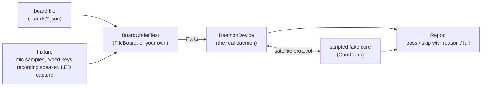

# Device conformance suite

Status: Draft, built. Contract: [spec 0006](../specs/0006-device-layer-contract.md) section 9 (REQ-DEV-011). Crate: `crates/device-conformance` (`clawdot-device-conformance`). Daemon: [device-daemon](device-daemon.md).

The suite is how a board proves it meets the device layer contract. It is also the evidence for the claim at the centre of [ADR-0015](../adr/0015-own-the-device-layer.md): **develop once, and the only per-device difference is how it is installed.** Three shipped board files (desktop, Raspberry Pi, Echo Dot 2) run through the same daemon and the same cases; nothing in the daemon changes between them.

## What it does



Each case is a function named for its requirement (`req_dev_005_stop_without_the_wake_word`) that builds the board, drives the real daemon against a scripted core on a loopback socket, and returns pass, skip with a reason, or fail. Some cases run twice: the board as its file describes it (**full** profile) and the same board with no LEDs, no buttons and no mute control (**stripped** profile), which checks the documented equivalents of spec 0006 section 5.

| Case | Shows |
|---|---|
| 001 | The daemon's own modules contain no board names; every board runs through the one daemon type |
| 002 | `hello` declares exactly what the board has and the build implements, and nothing the file does not allow |
| 003 | 20 ms 16 kHz mono frames up, reply audio down, `playback-done` after it finished |
| 004 | The 14 LED states, unknown states refused in a board file, precedence, the core's indicators drive the LED |
| 005 | Stop by the board's own gesture with no core, and by `stop-playback`, silences the speaker |
| 006 | Quiet hours cap the volume, dim the LEDs and defer announcements with no core; nothing changes outside the window or with no settings |
| 007 | The update mode is declared (`ab` is skipped: signatures and rollback need the unit) |
| 008 | The board file validates; an unknown key, an impossible rate, a future schema, a shell-looking argument and a `..` path are each refused naming the key |
| 012 | The file claims at least the minimum hardware; below it is refused |
| 013 | Stripped profile: absent LEDs, buttons and hardware mute are declared absent, each has an equivalent, the error state still makes a sound |
| 014 | Built-in tones play locally with no core |
| 015 | Software mute is never reported as hardware; no microphone audio while muted |
| 016 | Skipped with a reason on every board today: the daemon has no other audio source to duck and does not read the board's duck level. `GainOut` ducking is covered by a unit test of its own |
| 017 | The wake-engine seam (frame in, detection out, muted means not fed) and push-to-talk from the board's talk button |
| 019 | Forbidden paths and `..` are refused |
| 020 | Bounded button queue keeping the newest event; with no core the LED says offline and the mute button still works |
| 021 | The daemon manifest has no C build step or `-sys` dependency |

Reported but not run off hardware or not built: 009 (core-driven), 010 (Wi-Fi setup), 018 (clock trust), 022 (RSS and CPU on the unit), 023 and 024 (Bluetooth and Spotify Connect, optional).

## Running it

```
scripts/cargo.sh test -p clawdot-device-conformance                 # all boards, all cases (part of the normal gate)
scripts/cargo.sh test -p clawdot-device-conformance desktop::       # one board
scripts/cargo.sh test -p clawdot-device-conformance -- --nocapture conformance_report   # print the Markdown report
```

CI runs it as part of `cargo test --workspace`. A pull request that breaks a Must case fails.

## How a new board proves itself

1. **Write the board file** (`boards/<name>.json`) against [`schemas/board/board-1.schema.json`](../../schemas/board/README.md). Check it: `clawdot-device --board boards/<name>.json --check` prints what it declares and the equivalent for everything absent.
2. **Add it to the suite**, one block in `crates/device-conformance/tests/boards.rs`:
   ```rust
   mod my_board {
       clawdot_device_conformance::conformance_tests!(clawdot_device_conformance::FileBoard::new(
           include_str!("../../../boards/my-board.json")
       ));
   }
   ```
   `FileBoard` uses the daemon's own `ConfiguredBoard` with audio, keys and LED output replaced by the fixture, so this step needs no hardware. Every Must case must pass or be skipped with a stated reason.
3. **Install the daemon and the board file on the unit** (the image recipe's job) and run the same cases there. A board with real drivers implements `BoardUnderTest` itself (build its real `Parts`) and returns `true` from `on_hardware`, which skips the cases that need to observe the speaker or feed the microphone; those are checked by listening (the install guide lists them).
4. **Record the run**: the Markdown from `Report::markdown()` (date, daemon version, board-file hash, passed and skipped with reasons) goes in the board's install guide. A board is *supported* when every Must passes or is skipped with a reason that is itself recorded.
5. **If the daemon had to change for the board, the contract was wrong.** Amend spec 0006 first, then the daemon.

## What it does not prove

- Real audio, real LEDs, real buttons, real clocks, real power failures: the cases use recorded and scripted stand-ins. The unit run is the evidence for those.
- A device driver this build does not implement (`alsa` audio, input-device buttons, `ledctrl`): the Dot's file passes because the daemon degrades those to absent and reports it, not because they work. Cases that depend on them are skipped or run through the protocol path.
- Resource figures (REQ-DEV-022) and signed updates (REQ-DEV-007): measured and shown on the unit.
