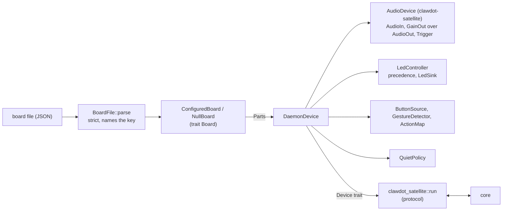

# Device daemon

Status: Draft, skeleton built. Contract: [spec 0006](../specs/0006-device-layer-contract.md). Decision: [ADR-0015](../adr/0015-own-the-device-layer.md) (Proposed, behind the B2/B3 gate). Crate: `crates/device` (`clawdot-device`, binary `clawdot-device`).

The daemon is one program for every board. A board is a JSON file ([schema](../../schemas/board/README.md)); the daemon has no code path chosen by a board name. It speaks the satellite protocol through the reference satellite crate and adds what the device layer owns.

## Shape



| Module | Does | Requirements |
|---|---|---|
| `board_file` | Load and validate a board file; closed objects, ranges, cross-checks; error names the dotted key | REQ-DEV-008, 012, 019 |
| `caps` | Capability list; what is declared is what the file allows and this build implements; documented equivalents; protocol `hello` capabilities | REQ-DEV-002, 013 |
| `board` | `Board` trait, `NullBoard`, `ConfiguredBoard`, embedded boards, `load` | REQ-DEV-001, REQ-BRD-002, 015 |
| `led` | The 14 logical states, precedence, `ConsoleLeds`, `LedController` | REQ-DEV-004 |
| `button` | Raw edges, gestures (press, long, double), action map, terminal keys | REQ-BRD-007, REQ-DEV-005 |
| `tone` | Built-in tones | REQ-DEV-014 |
| `quiet` | Quiet-hours window, volume ceiling, LED dimming, announcement deferral | REQ-DEV-006 |
| `wake` | `WakeEngine` seam, refractory filter, sensitivity, router, test engine | REQ-DEV-017 |
| `daemon` | `DaemonDevice`, `GainOut` (software volume and ducking), `run_forever` (reconnect, local functions while offline) | REQ-DEV-005, 006, 014, 015, 016, 020 |

## What exists and what does not

| Area | State |
|---|---|
| Board file loading, schema, three examples | Built and tested |
| Command and default audio backends (`ffmpeg`, `sox`, `arecord`, `aplay`) from the satellite crate | Used; the board file selects them with `kind: default` or `command` |
| `alsa` audio kind, input-device (`evdev`) buttons, `ledctrl`, `frame` and `sysfs` LED drivers | Accepted by the schema, **not implemented**: LEDs and buttons degrade to absent with a reported problem; audio stops startup with a message naming the key |
| Console LEDs, terminal-key buttons, push-to-talk | Built (the desktop board) |
| Wake engine | **None.** The seam exists. Always-on capture for an engine needs a change to the audio front end and arrives with the first engine |
| Echo cancellation | **None** |
| Ducking of other sources, Bluetooth, Spotify Connect, Wi-Fi setup, clock trust, updates | Not built; declared absent with the equivalent |
| Quiet-hours settings from the core | Not on the wire yet (spec 0006 section 8); set with `--quiet` |
| Local cancel reaches the core | Not on the wire yet; playback is silenced and capture closed locally |
| Mixer routes (`audio.mixer_routes`) | Validated, not applied (needs the ALSA backend) |

## Running it

```
clawdot-device --board desktop --check                    # validate and print what it declares
clawdot-device --board desktop --core 127.0.0.1:10400     # t + Enter talks, s stop, m mute, q quits
clawdot-device --board my-board.json --check              # a board file of your own
```

`--check` prints one line per capability: class, present or absent, and, if absent, the equivalent the user gets instead.

## Size and dependencies

| Item | Value |
|---|---|
| New dependencies | None. `serde_json` and `clawdot-protocol` are already in the workspace; the daemon depends on `clawdot-satellite` for the audio traits, the command backends and the protocol loop |
| `clawdot-device` release binary, armv7 musl (`--release`, size profile, stripped), 2026-11-09 | 664,920 bytes (649 KiB) |
| `clawdot-satellite` on the same target, for comparison | 589,944 bytes (576 KiB), so the daemon layer adds about 73 KiB |
| Against the budget | The daemon is a separate binary from the core; REQ-NFR-103 (8 MB) applies to the core. REQ-DEV-022 sets the daemon's own proposed limit (3 MB, 16 MB RSS); RSS is not yet measured |
| `unsafe` | None (`unsafe_code = "forbid"` from the workspace) |

Measured with the zig linker wrappers of `scripts/setup-wsl.sh`; RSS and CPU wait for the unit (B3).
