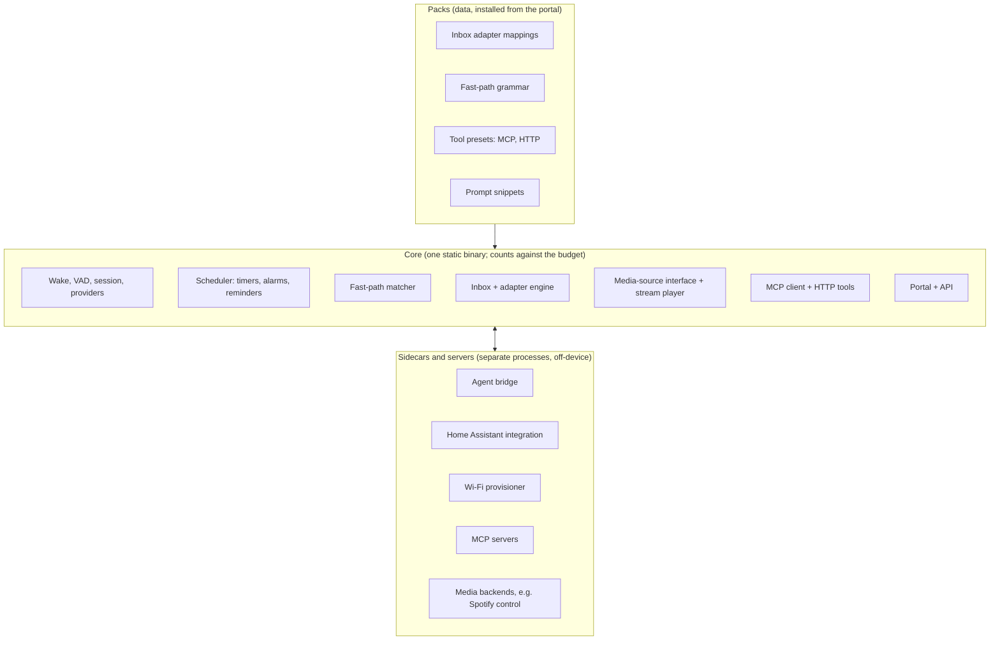

# Extensibility

Status: Draft. Decision record: [ADR-0010](../adr/0010-extension-model.md). Requirements: [spec 0001 §4.9](../specs/0001-product-requirements.md).

## Principle

**Bundle what the v1.0 definition needs and what is tiny. Everything else is data or a separate process. The core loads no third-party code.**

## Three rings



| Ring | What lives here | How it's added | Counts against budget? |
|---|---|---|---|
| **Core** | Wake word, STT/LLM/TTS clients, scheduler, fast-path, inbox with `claude-code` and `generic` adapters, portal, stream player, MCP client, HTTP tools | Part of the binary | Yes |
| **Packs** | Adapter mappings, grammar, tool presets, prompt snippets | Portal: paste a URL or pick from an index; hash-pinned. **User-installable packs ship in v1.x**; in v1.0 the format is used internally for the bundled adapters. | Marginally (data) |
| **Sidecars / servers** | Agent bridge, Home Assistant integration, Wi-Fi provisioner, MCP servers, heavy media backends | Docker, package, HACS, or another host | No (off-device) |

**Bundle rule:** bundle if it is essential to the v1.0 definition *and* small (roughly under 100 KB, no heavy dependencies). Otherwise it is a pack or a sidecar.

## Integration mechanisms

| You want to... | Use |
|---|---|
| Add a tool that calls an HTTP API (Home Assistant, a webhook) | **HTTP tool** (config or pack) |
| Add a rich or stateful tool set | **MCP server** (Streamable HTTP) |
| Support another agent's hook format (Codex, Gemini, Home Assistant events) | **Adapter mapping** (pack) |
| Add voice commands without an LLM call | **Fast-path grammar** (pack) |
| Add a music/audio source | **Media backend** (see below) |
| Talk to an agent that needs a long-lived process (Claude Code resume) | **Agent bridge** (sidecar, pulls replies over SSE) |
| Show state on a screen | Read semantic **display events** (satellite) or the `/display` page |

## Media-source interface

Music is agnostic by design. A backend declares **capabilities** (search, play, pause/resume, next/previous, queue, volume, now-playing, resume position) and one of two shapes:

- **Playback shape:** ClawDot receives an audio stream and plays it on its own speaker. Shipped in v1.0: internet radio and plain HTTP streams. Library servers (Subsonic-compatible, Plex, Jellyfin, Audiobookshelf) fit here by returning stream URLs.
- **Control shape:** ClawDot sends commands to a player elsewhere (Spotify Connect device, MPD, Music Assistant, a Home Assistant media player). Audio plays *there*, not on ClawDot's speaker. Spotify control via its Web API is this shape.

Playing Spotify *on ClawDot's own speaker* would need a Spotify Connect receiver on the device. That has budget and terms-of-service questions and is parked in [future-scope.md](../future-scope.md).

Resume positions (podcasts, audiobooks) are persisted by the core per item when the backend supports them.

## Example recipes

- **Home Assistant → ClawDot:** an HA automation POSTs to a `generic` inbox endpoint ("front door opened").
- **ClawDot → Home Assistant:** an HTTP tool forwarding the utterance to HA's conversation API (or an MCP connection to HA's MCP server). To be verified at M5.
- **Hermes as the brain:** point the LLM provider at Hermes's OpenAI-compatible gateway. Or Hermes → ClawDot through an HTTP call to an inbox endpoint. Verify against Hermes's own docs.
- **Claude Code:** native `http` hook to a `claude-code` endpoint; the bridge sidecar pulls replies over SSE and runs `claude -p --resume`.

## Managing tools, connections, and skills from the portal

The portal (REQ-CFG-032..036) edits three small files in the data directory, written atomically through the same store as the other state. The hand-written configuration file is never touched.

| File | Holds |
|---|---|
| `tools.json` | HTTP tools added in the portal, and the names of tools turned off (built in, from the config file, or portal tools) |
| `connections.json` | MCP servers added in the portal, and the servers and tools turned off |
| `skills.json` | Skills |

At start-up the core loads the config-file entries first, then the portal ones. A portal entry that no longer validates (for example its token variable is no longer set) is kept in the file, not loaded, and shown with the reason. Changes apply to the running assistant at once. Only the **name** of a token environment variable is ever accepted; the value is read from the environment by the core and never passes through the portal.

### Skills

A skill is a named, switchable bundle of instructions for the assistant, stored as data (no code, REQ-EXT-001):

```json
{ "name": "good night", "enabled": true,
  "instructions": "When I say good night, turn off the lights and set an alarm for 7:00 on weekdays.",
  "tools": ["set_light", "set_alarm"] }
```

| Field | Meaning |
|---|---|
| `name` | Up to 40 characters; unique. |
| `instructions` | Up to 2000 characters of plain text, written by the administrator. |
| `tools` | Optional. The tools the skill relies on. They are named in the prompt so the model knows what to reach for. It is not a permission: a tool that is off stays off, and the confirm policy always applies. |
| `enabled` | Off skills are stored but not used. |

How it works: every turn, the instructions of the enabled skills are added to the system prompt after the persona, under a heading that says they are the user's own standing instructions and cannot change the confirm policy or the rules about untrusted text. At most 16 skills; the added text is capped so one skill cannot crowd out the conversation. Export gives a JSON file `{"format":"clawdot-skills","version":1,"skills":[...]}`; import accepts the same and adds the skills **turned off**, because an imported skill is text from somewhere else and should be read before it is trusted.

This is the minimal useful definition; richer skills (triggers, parameters, bundled tools) are future scope. The decision is logged in [open-questions.md](../open-questions.md).

## Trust model for packs and tools

1. Packs are data. No code executes on the device because of a pack.
2. A pack declares the tools, endpoints, and policies it adds; the portal shows this before install and requires explicit approval.
3. A pack cannot disable the `confirm` policy, the untrusted-text handling, or the usage limits.
4. HTTP tool URLs are admin-configured; the LLM supplies only schema-validated parameters.
5. Packs are pinned by hash and version. Updates require re-approval if requested permissions grow.
6. The core never fetches or runs anything from a pack at runtime beyond its declared data.

## What this explicitly excludes

In-process native plugins, scripting or WASM runtimes, and remote code download. Revisit only through a new ADR.
