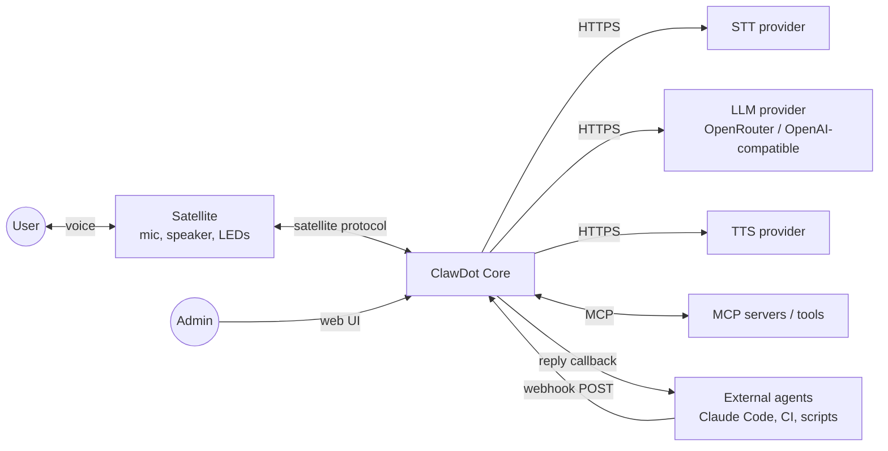
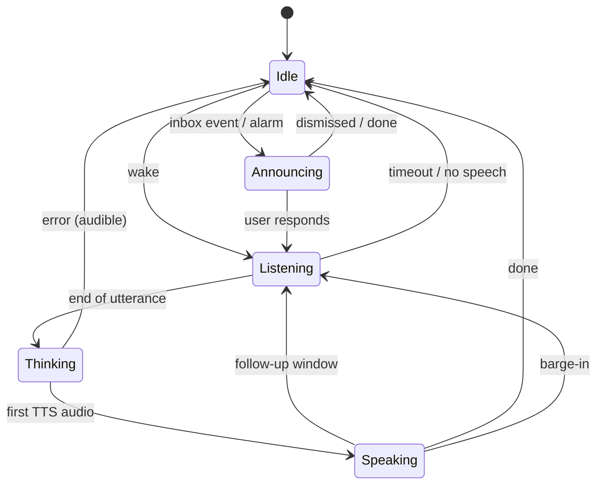
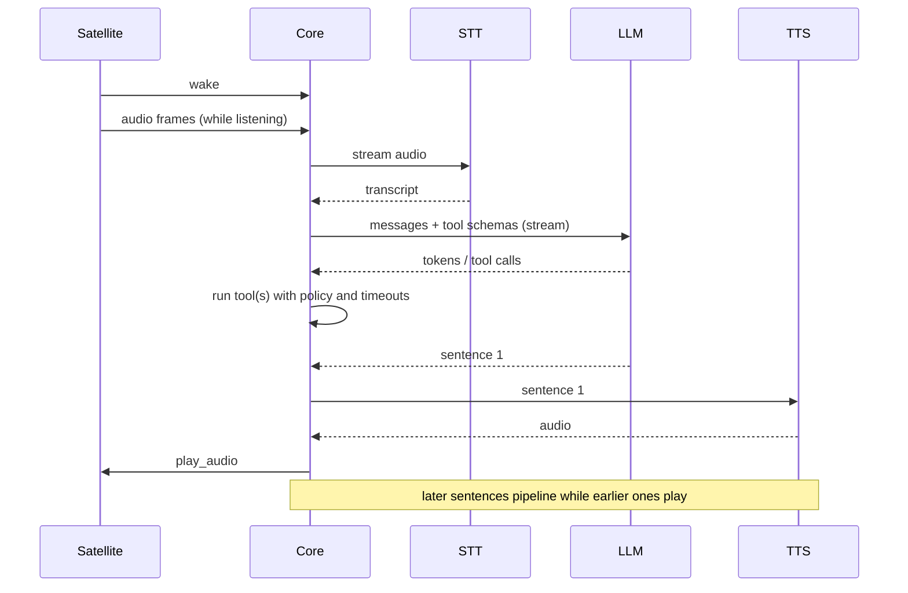
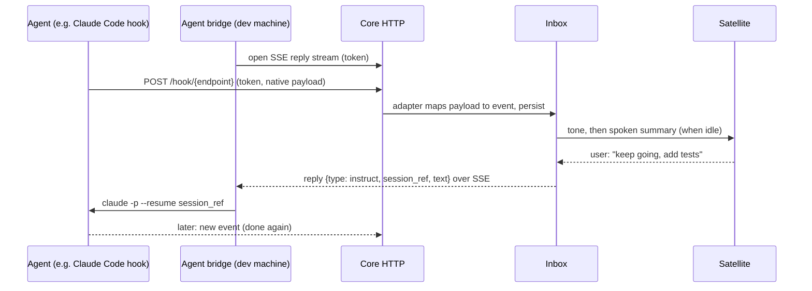

# Architecture Overview

Status: Draft. Describes intended design; updated as specs are accepted and code lands.

## 1. Context

By default the satellite and core run **in one process** on the same device. The protocol lets them be split across machines, so an ESP32 or Pi can be a satellite for a remote core.

## 2. Guiding constraints

1. The whole system fits the [resource budget](../specs/0002-resource-budget.md) (≤ 64 MB RSS hard gate, 48 MB target; ≤ 8 MB binary).
2. The core knows nothing about hardware; the satellite knows nothing about AI.
3. All I/O is bounded: queues, buffers, history, logs.
4. External text is untrusted, including LLM output, inbox events, and tool results.
5. State is persisted atomically; the process may be killed at any moment.

## 3. Components

| Component | Responsibility | Crate (planned) |
|---|---|---|
| **protocol** | Message types, framing, schemas, conformance helpers. Shared by core and every satellite written in Rust. | `crates/protocol` |
| **satellite (trait + transports)** | Abstract mic/speaker/events; in-process and WebSocket transports. | `crates/satellite-api` |
| **satellite-desktop** | Reference satellite for development (laptop mic/speaker). | `crates/satellite-desktop` |
| **wake** | Wake-word inference over audio frames. Pluggable engine. | `crates/wake` |
| **vad/endpointing** | Detect speech start and end. | `crates/audio` |
| **session** | Conversation state machine; orchestrates a turn. | `crates/core` |
| **providers** | `Stt`, `Llm`, `Tts` traits and HTTP implementations. | `crates/providers` |
| **tools** | Tool registry, schemas, policy (confirm/deny), built-ins, MCP client. | `crates/tools` |
| **scheduler** | Timers, alarms, reminders; monotonic and wall-clock handling. | `crates/sched` |
| **inbox** | Endpoints, event queue, announcement policy, reply relay. | `crates/inbox` |
| **music** | Backend trait, HTTP stream player, ducking. | `crates/music` |
| **store** | Atomic JSON persistence, bounded collections. | `crates/store` |
| **http** | Web UI, config API, webhook ingress, health. Embedded static assets. | `crates/http` |
| **config** | Single-file config, validation, hot reload. | `crates/config` |
| **budget** | Benchmark scenarios and the CI gate tooling. | `tools/budget` |

Crate count is a size and compile-time trade-off and will be revisited. Boundaries are logical first.

## 4. Conversation state machine

Alarms and inbox announcements preempt `Idle` only. Alarms may preempt other states; this is a policy to be specified in a spec.

## 5. Turn pipeline (streaming)

Latency is managed by overlapping stages: STT while speaking, sentence-level TTS while the LLM generates.

## 6. Agent inbox flow

The device never calls out to agent hosts; the bridge pulls. Reply types are `ack`, `instruct`, `snooze`, `dismiss`, and `details`. Transport options are covered in [ADR-0006](../adr/0006-inbox-transport.md).

## 7. Data and persistence

| Data | Store | Bound |
|---|---|---|
| Config | `config.toml` | n/a |
| Timers, alarms, reminders | JSON file, atomic write | max items configurable |
| Inbox events | Append log with compaction | max N events / bytes; when full, the endpoint holding more than half the queue gives up events first, so one token holder cannot evict another endpoint's events |
| Endpoint tokens | Config (hashed) | n/a |
| Conversation history | Memory only | token and byte capped |
| Logs | Ring buffer + optional file | bytes capped |

No raw audio is ever stored.

The endpoint, inbox and reply files are compact JSON, and a change rewrites only the file it changed (an acknowledgement from a bridge touches `replies.json` alone). The core serialises under its lock and a small writer thread does the writes, coalescing several changes to one file into one write, so neither the lock nor the async runtime waits for flash. The HTTP layer awaits that thread before it answers, so a webhook, announcement or acknowledgement that was reported as accepted is on disk (REQ-INB-004).

The timers file and the usage counters use the same writer, so the main loop never waits for flash on them either. A reply that tells the user a timer, alarm or reminder is set is held back (in its own task, not in the loop) until that change is on disk, so a crash right after "Timer set" cannot lose it (REQ-TMR-003). The usage counters are not waited for: they can lag by the write in flight, are queued after every model turn, and are flushed when the console closes or `quit` is typed. A SIGTERM ends the process at once, as for any program without a handler, and drops writes still queued.

## 8. Cross-cutting concerns

- **Errors:** typed errors with context; user-facing failures are spoken in plain language.
- **Observability:** structured logs, a small metrics endpoint (RSS, queue depth, provider latency).
- **Time:** monotonic clock for durations, wall clock for alarms; clock validity is a first-class state. Which is which: [the agent loop, "Time"](agent-loop.md).
- **Concurrency:** single-threaded async executor for logic, and a dedicated audio thread/callbacks for real-time paths.
- **Configuration:** one file, schema-validated, with secrets separated.

## 9. Extension points

| Extension | Mechanism |
|---|---|
| New hardware | Implement a satellite per the protocol |
| New tools | MCP server (Streamable HTTP), declarative HTTP tool, or pack; built-in `Tool` trait for core tools |
| New providers | `Stt`/`Llm`/`Tts` trait; OpenAI-compatible HTTP by default |
| New audio/music source | Media backend (playback or control shape), see [extensibility](extensibility.md) |
| New agent or event source | Inbox adapter mapping (pack) |
| Anything else | Sidecar through the documented core API ([ADR-0010](../adr/0010-extension-model.md)) |
| New wake engine | `WakeEngine` trait |

## 10. Risks (tracked)

| Risk | Mitigation |
|---|---|
| Echo Dot Gen 2 cannot be unlocked or has unusable audio paths | Design is hardware-agnostic; the Dot is a stretch port and the budget remains the benchmark (SPIKE-001) |
| Wake-word runtime exceeds budget | SPIKE-002; alternative engines behind `WakeEngine` |
| Software AEC quality is insufficient for barge-in | Barge-in is "Should"; fall back to wake-word-only interruption |
| TLS memory overhead | SPIKE-003; connection reuse, buffer tuning |
| Prompt injection via inbox/tool output | REQ-INB-010, [threat model](../security/threat-model.md) |
