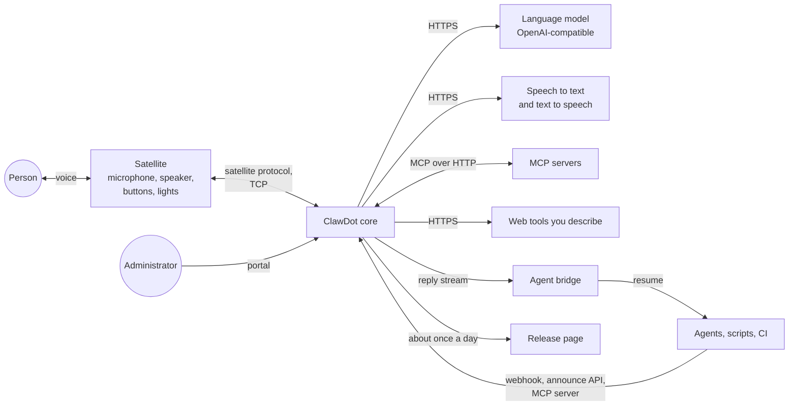

# Architecture overview

Status: describes the code on `dev` as of 2026-11-12. Things that are planned and not built are in the [roadmap](../roadmap.md), not here.

ClawDot is one program, the **core**, that holds the assistant: the language-model turn, the tools, the timers, the inbox and the web portal. A **satellite** (a microphone, a speaker and optional buttons and lights) connects to it over a small protocol, and the core knows nothing else about the hardware.

## 1. Context

The satellite can be a computer (the reference satellite), a board running the device daemon, or an ESPHome voice device that the core dials (feature `esphome-satellite`). The core also has a text console, which stands in for a satellite when none is connected. There is no in-process satellite: audio always arrives over a connection.

## 2. The crates

| Crate | What it is today |
|---|---|
| `crates/core` | The `clawdot` program: dialog, turns, tools and the gate, inbox, timers, notes, settings, the HTTP server, the MCP server and client, the portal's API, the updater. About 3.4 MB stripped for the Dot build. |
| `crates/protocol` | The wire format between core and satellite: framing, typed messages, the bridge reply types. No I/O, no async runtime. |
| `crates/satellite` | A reference satellite using only the standard library. Its device is a WAV file or a command, for development. |
| `crates/device` | The portable device daemon: board files, a capability model, LED states, buttons, tones, quiet hours, and the wake-engine seam, over the satellite protocol. |
| `crates/device-conformance` | A suite that runs the device contract ([spec 0006](../specs/0006-device-layer-contract.md)) against any board with a fake core. |
| `crates/wake` | A wake-word runtime for streaming microWakeWord models: model reader, audio front end and an int8 interpreter, in safe Rust with no dependencies. |
| `crates/bridge` | The agent bridge: reads spoken replies from a speaker over server-sent events and resumes the coding agent with them. |
| `crates/eval` | Scenario evaluation of the agent loop: replayed in CI, or live with a spending cap. A development tool, not in the product binary. |
| `crates/e2e` | End-to-end tests with a real HTTP server and a real bridge client. |
| `portal/` | The web portal in TypeScript and Preact. It is bundled into one page, committed as `crates/core/src/ui.html`, and compiled into the core. |
| `bridges/` | Small Python bridges to chat and notification services, outside the Rust workspace. |

Optional features of `clawdot-core` (all off except the first two): `tz` (time-zone database), `tls` (HTTPS to providers), `esphome-satellite`, `esphome-noise`, `realtime` (speech-to-speech voice), `hive` (device identity and mDNS discovery). The Dot build uses `esphome-satellite,esphome-noise`.

## 3. Inside the core

### Start-up and the loop

`main.rs` reads the environment once (`env.rs`), parses the arguments into a `Cli` and the `--config` file into a `Config` (`cli.rs`), runs a one-shot command if asked (`say`, `--create-endpoint`, `--reset-admin`, `--voice-in`), and otherwise calls `startup::start`. That first resolves the three layers and the saved settings into one immutable `Resolved` (`seed.rs`), which the rest reads by reference, and then runs a fixed sequence: settings, clock, the stores, the brain, the listening socket (bound before any token is printed), the satellite servers, hive discovery, the update check. It returns an `App`.

`app_loop.rs` is the running application: **one loop that owns the state** (the built-in tools and timers, the portal's tools and skills, settings, the usage files) and reacts to events. Slow work does not run in it. A model turn, a realtime session, speech and a new MCP connection are tasks that send their results back as messages ([ADR-0021](../adr/0021-turns-as-tasks.md)). `runtime.rs` holds the `Brain` (live settings, the status snapshot); what the loop does with a turn, a portal change and a connection result is on `App`, in `app_loop/`.

### A turn

An utterance (or a typed line) goes to the local fast path first (`fastpath.rs`, `assistant.rs`): timers, alarms, volume, music, with no model call. The words it listens for (the grammar, number and clock words, yes and no, note commands, day and month names) are data in `lang.rs` and `lang/en.rs`; the logic takes a `Language` chosen once at start-up, and the full spoken sentences are not moved there yet. Anything else becomes a model turn (`turns.rs`) in a task, with that speaker's own conversation (`speakers.rs`: at most 8 conversations, bounded in messages, bytes and idle time). The turn runs `session::run_turn_with`, which loops: ask the model, validate its calls, pass each call through the **gate** (`session/gate.rs`), add the result, repeat until a limit or an answer. Durations (timers, confirmation windows, sessions) are measured on a monotonic clock, so a correction of the wall clock cannot stretch or cut them; calendar points (alarms, reminders at a time) follow the wall clock. Details: [agent loop](agent-loop.md) (see "Time"), [action safety](action-safety.md).

The gate decides every call: risk tier, a spoken read-back and a plain "yes" held by the host for costly actions, the audit record, the daily caps, dry-run, cancel. The model cannot release a held action. Realtime voice calls the same gate.

### Tools

A turn sees one tool host built in layers: built-in tools (`assistant/tools.rs`: timers, alarms, reminders, stopwatch, music, inbox), then HTTP tools described by the administrator ([http-tools.md](http-tools.md)), then tools from MCP servers ([mcp.md](mcp.md)), under a policy layer that applies what the administrator switched off or re-tiered. Built-in tools change state the loop owns, so a turn sends them to the loop; HTTP and MCP tools are called by the turn task itself. Skills (`SKILL.md` folders) add instructions and may limit the tools a turn can use ([extensibility.md](extensibility.md)).

### The inbox

Agents post to `POST /hook/{endpoint}` or `POST /api/announce`, or call the core's own MCP server at `POST /mcp`. An adapter maps the payload to an event; the queue is bounded per endpoint (`inbox/`). The speaker task says events in order, summarised and with their source named. Replies from the person go out on an SSE stream per endpoint (`/bridge/{endpoint}/replies`) that the agent bridge reads and acknowledges.

### State and storage

`store.rs` writes small JSON files atomically (temporary file, flush, rename) with a schema version and private permissions. A single writer thread (`app/persist.rs`) does the writes and coalesces changes to one file, so neither the loop nor the async runtime waits for flash; the HTTP layer waits for it before it reports an inbox change as accepted. There is no database.

### The HTTP server

`http.rs` and `ui.rs` serve from two route tables (`routes.rs` defines the row type, the matcher and the auth classes). `http::ROUTES` holds the page, health, webhooks, announce, the MCP server and the bridge. `ui::ROUTES` holds the portal's `/api`. Each row names its auth class (public, sign-in routes, administrator session, endpoint token, any endpoint token, endpoint token or administrator), and the OpenAPI file ([../api/openapi.yaml](../api/openapi.yaml)) is checked against both tables. Connection counts are capped overall and per address (`limit.rs`), the `Host` header is checked against the device's own names (`hostguard.rs`), and failed sign-ins and token guesses share a rate limit.

### The portal, settings and secrets

The portal is one static page with no external assets. Settings (`settings.rs`) are one table with a row per setting, layered: defaults, the configuration file, `settings.json` (what the portal saved), flags. Most apply without a restart ([configuration.md](configuration.md)). Provider keys pasted into the portal go to `secrets.json` (mode 0600, never returned whole, never in an export). A key can instead be named by an environment variable.

### The updater

`update.rs` checks a release page about once a day, and installs only on confirmation, only a release whose checksum file carries a valid signature from the project key, and keeps the previous program ([updates guide](../guides/updates.md), [ADR-0019](../adr/0019-updates-and-remote-access.md)).

### Satellites and voice

`satellite.rs` serves the satellite protocol; `voice.rs` is the dialog state machine (who may listen when), `vad.rs` finds the end of an utterance, `speech.rs` (with a file per provider under `speech/`, the shared HTTP client `apiclient.rs`, and `audio.rs` and `netpolicy.rs` for PCM/WAV and the plain-http rule) and `speechio.rs` reach the speech services, and `rtvoice.rs` plus `realtime/` are the optional realtime path. `esphome/` is the client for ESPHome voice devices. See [voice pipeline](voice-pipeline.md), [satellite server](satellite-server.md) and [ESPHome satellite](esphome-satellite.md).

## 4. Trust boundaries

Text from the language model, tool results, MCP servers, webhooks and agents is untrusted data. It is never allowed to change a tier, release a held action or write a note. Credentials differ by route: an administrator session (or a private-network peer in open mode) for the portal, a per-endpoint token for webhooks, the bridge and the MCP server, a separate token for satellites. The portal is plain HTTP on the local network; use a trusted network or a VPN. See the [threat model](../security/threat-model.md), [action safety](action-safety.md), [SECURITY.md](../../SECURITY.md) and [PRIVACY.md](../../PRIVACY.md).

## 5. Where state lives

Everything is in the data directory (`--data-dir`, default `./clawdot-data`). No raw audio is stored.

| File | Holds |
|---|---|
| `admin.json` | The administrator setting and the password hash |
| `settings.json` | Settings saved from the portal |
| `secrets.json` | Provider keys pasted into the portal |
| `endpoints.json` | Webhook endpoints (token hashes, adapter, spoken name) |
| `inbox.json`, `replies.json` | Queued agent events and pending replies |
| `timers.json` | Timers, alarms, reminders, the stopwatch |
| `usage.json` | The day's request and spend counters |
| `audit.jsonl`, `audit.1.jsonl` | The audit log, rotated at a size cap |
| `memory.json` | Notes the user asked to keep (only if enabled) |
| `tools.json`, `connections.json`, `skills.json` | Tools, MCP connections and skills managed in the portal |
| `update.json` | Update-check state |
| `hive-identity.json` | The device's identity key (only with `hive`) |

The configuration file you write by hand is never rewritten by the core.

## 6. Resource budget

The budget ([spec 0002](../specs/0002-resource-budget.md)) is a feature: default configuration must fit a 512 MB device (idle RSS at most 24 MB, peak at most 64 MB, binary at most 8 MB). Measured on 2026-11-11 ([proving pass](../reports/2026-11-11-proving-pass.md), [architecture review](../reports/2026-11-11-architecture-review.md)):

| Measure | Result |
|---|---|
| Release binary, armv7 musl, features the Dot uses | 3,247,568 bytes |
| Same with `hive` and `realtime` | 3,348,880 bytes |
| Idle memory on the first device it ran on | 2.95 MB resident, one thread |

CI builds both armv7 binaries and fails over 8 MiB. Peak memory across the benchmark scenarios is not measured yet.

## 7. Extension points

| To add | Use |
|---|---|
| Hardware | A satellite that speaks the protocol ([porting](porting-a-satellite.md), [board support](board-support.md)) |
| Tools | An MCP server, a declarative HTTP tool, or a skill |
| Music source | A media backend ([media.md](media.md)) |
| An agent or event source | An inbox adapter and an endpoint ([recipes](../recipes/README.md)) |
| Anything else | A sidecar through the documented API ([ADR-0010](../adr/0010-extension-model.md)) |
