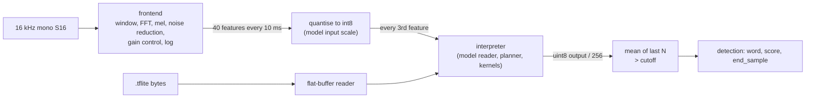

# Wake-word runtime

Status: Draft, in build. Contract: [spec 0007](../specs/0007-wake-word-runtime.md). Evidence and engine choice: [R-11](../research/11-wake-word-spike.md). Crate: `crates/wake` (`clawdot-wake`), adapter in `crates/device` behind the `mww` feature.

The runtime runs the official streaming int8 microWakeWord models without TensorFlow, tract or any C code. It is three small parts and a decision rule.

## Shape

| Module (`crates/wake/src`) | Does |
|---|---|
| `flat` | Bounds-checked reader for the FlatBuffers wire format (tables, vectors, strings); never indexes unchecked |
| `model` | Reads the TFLite schema into plain structs: tensors, quantisation, operators and their options, constant data ranges; enforces the limits of spec 0007 section 5 and refuses unsupported operators |
| `frontend` | Port of the TensorFlow Lite Micro audio frontend in integer arithmetic |
| `kernels` | int8 convolution, depthwise convolution, fully connected, concatenation, strided slice, split, requantise, logistic |
| `interp` | Plans the activation arena from tensor lifetimes, owns the streaming variable buffers, runs the operators in order |
| `engine` | Frontend plus one interpreter per word; the sliding-window decision rule; sensitivity to cutoff |
| `sha256` | Small SHA-256 for the model hash in `WordInfo` (avoids a dependency) |

## Provenance of the port

The frontend follows the algorithm of the TensorFlow Lite Micro microfrontend (`tensorflow/lite/experimental/microfrontend`, Apache-2.0, copyright The TensorFlow Authors) and of the kiss FFT in its 16-bit fixed-point configuration (BSD-3-Clause, copyright Mark Borgerding). It was written from the published algorithm and checked against the reference output, not copied file by file; the notices are carried in the crate's `NOTICE` text and in `NOTICE` at the repository root.
