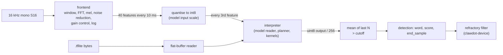

# Wake-word runtime

Status: Draft, built and validated on a PC. Contract: [spec 0007](../specs/0007-wake-word-runtime.md). Evidence and engine choice: [R-11](../research/11-wake-word-spike.md). Crate: `crates/wake` (`clawdot-wake`), adapter in `crates/device` behind the `mww` feature (off by default).

The runtime runs the official streaming int8 microWakeWord models without TensorFlow, tract or any C code: a flat-buffer reader, a port of the TensorFlow Lite Micro audio frontend, an interpreter for the 13 operator kinds these models use, and the reference decision rule.

## Shape

| Module (`crates/wake/src`) | Does |
|---|---|
| `flat` | Bounds-checked reader for the FlatBuffers wire format; never indexes unchecked |
| `model` | Reads the TFLite schema into plain structs; enforces the limits of spec 0007 section 5; refuses unsupported operators by name |
| `frontend` | Port of the microfrontend in integer arithmetic, including its 16-bit fixed-point FFT |
| `kernels` | int8 convolution, depthwise convolution, fully connected, requantisation, logistic table |
| `interp` | Plans the activation arena from tensor lifetimes, owns the streaming variable buffers, runs the operators; optional tensor trace for comparing with another implementation |
| `engine` | One frontend, one interpreter per word, the sliding-window rule, cutoff |
| `sha256` | Model hash for `WordInfo` (avoids a dependency) |
| `crates/device/src/wake_mww.rs` | `MwwEngine`: `WakeEngine` over the above; word ids, provenance, sensitivity to cutoff, refractory |

Supported operators: `CONV_2D`, `DEPTHWISE_CONV_2D`, `FULLY_CONNECTED`, `CONCATENATION`, `STRIDED_SLICE`, `SPLIT_V`, `RESHAPE`, `LOGISTIC`, `QUANTIZE`, `CALL_ONCE`, `VAR_HANDLE`, `READ_VARIABLE`, `ASSIGN_VARIABLE`. Both committed models (`okay_nabu`, `hey_mycroft`, official v2) load; `hey_jarvis` and `alexa` use the same set and were not committed. Streaming state is the model's own variables, started from the constants of its `CALL_ONCE` subgraph.

Sensitivity: the distance of the cutoff from 1.0 scales by 4 per half step (`cutoff = 1 - (1 - base) * 4^(2s - 1)`, clamped to 0.5 to 0.999), so 0.5 is the published cutoff (0.97 for `okay_nabu`, giving 0.9925 strict and 0.88 loose). The curve is a choice, not a measurement.

## Provenance of the port

The frontend follows the algorithm of the TensorFlow Lite Micro microfrontend (`tensorflow/lite/experimental/microfrontend`, Apache-2.0, The TensorFlow Authors) and of the kiss FFT in its 16-bit fixed-point configuration (BSD-3-Clause, Mark Borgerding). It was written from memory of the published algorithm and fitted to the reference output, not copied; see the notice in the repository `NOTICE`.

Three constants were found by comparison with the reference rather than from the source I remembered, and are marked in the code: the gain-control SNR shift is 6 (not 9), the window maximum ignores `-32768` (the reference keeps it in an `int16`, where its absolute value wraps), and the log table is regenerated (`round(65536 * (log2(1 + k/128) - k/128))`).

## Validation against the reference

Reference: `pymicro-wakeword` 2.5.0 (TensorFlow Lite C library, x86) and `pymicro-features` 2.0.2. Clips are synthesised by `spikes/wakeword/make_golden.py` (seeded noise, harmonics and formant filters; no recording). Two of the four clips are formant sequences that the models respond to, so their outputs pass through mid-range.

| Stage | Result (committed golden data) |
|---|---|
| Frontend features, streamed clips (4 clips, 25,000 values) | 99.3 to 99.8 % identical; 99.8 to 99.9 % within one step of the int8 model input |
| Frontend, 30 independent frames of very different level (1,200 values) | 99.75 % identical; 100 % within one step; worst one frontend unit |
| Worst frontend deviation | 133 units (51 input steps) in near-silent channels where the gain-control output is 1 against 0; up to 26 units in loud, clipped passages. Cause not found |
| Interpreter, reference features, `Rounding::GemmSingle` | **Bit-identical** in every output, both models, 4 clips (about 200 inferences each model, 49 in mid-range); also on random int8 streams |
| Same, every intermediate tensor (checked while developing, not committed) | Identical, all 43 activation tensors of `okay_nabu` over 63 inferences |
| Interpreter, `Rounding::Reference` (default) | Outputs identical in 89 to 100 % of inferences, worst difference 14 of 256 |
| End to end window mean (audio in, mean out) | 0 on negative clips; worst 0.032 (`hey_mycroft`, formant clip), 0.0125 for `okay_nabu` |
| Detection | `okay_nabu` fires once on its formant clip (score 0.973 against cutoff 0.97) and on none of the others |

Why two roundings. The TFLite reference kernels, and TFLite Micro on the device, round twice when scaling an accumulator (rounding multiply, then rounding shift). The matrix-multiply path of the TFLite C library on x86 rounds once for `CONV_2D` and `FULLY_CONNECTED` and uses the double form for `DEPTHWISE_CONV_2D`. The two agree except for about one value in a thousand, off by one, which accumulates to at most a few hundredths of probability after ten layers. This was found by dumping every intermediate tensor from the library (by making each the graph output) and comparing. `Rounding::GemmSingle` reproduces the library exactly and is used to validate everything else; the default follows the reference kernels the models were published for. R-11 guessed a tolerance of 0.02 on the window mean; the frontend differences alone move it by up to 0.032, so spec 0007 says 0.04.

## Measurements (PC, no device)

Machine: AMD Ryzen AI 9 365, WSL2 Ubuntu, one thread, `opt-level = "z"` with LTO (the workspace release profile), one word (`okay_nabu`), 288 s of audio, `wake_wav --repeat 200`.

| Measure | Value |
|---|---|
| CPU per second of audio | 0.24 % of one core (wall time of a single-threaded loop; 414 times real time) |
| Tensor arena plus streaming state | 8,064 bytes (`okay_nabu`), 7,680 bytes (`hey_mycroft`); TFLite Micro's published arena for the same models is 26,080 and 23,628 bytes |
| Model file kept in memory | 60,264 and 57,248 bytes |
| Whole engine, one word (file + arena + frontend + buffers) | about 75 KB (`memory_bytes`); two words about 140 KB |
| Peak resident memory of the example process | 3.5 MB total, 0.57 MB more than before the engine was built |
| armv7 musl binary: `wake_wav` with the engine | 484,512 bytes |
| Same example with the engine replaced by file reading only | 350,744 bytes, so the engine, the model reader and the example's WAV parsing cost about 131 KiB |
| `clawdot-device` daemon, armv7 musl, default build | 665,064 bytes (the engine is not linked; the feature is off) |

Extrapolation to a 1.2 GHz Cortex-A53, with the assumptions that R-11 section 7 used: the PC core is 6 to 12 times faster than an A53 for this kind of code, so 1.5 to 3 % of one A53 core for one word, and about 3 to 6 % with the scalar-FFT and interpreter overhead that a 32-bit in-order core adds. The model is 24 to 36 thousand multiply-accumulates every 30 ms (under 1.2 million a second); the frontend is one 512-point integer FFT every 10 ms. These are estimates. **No device number is claimed**: the armv7 build was not run (this machine's Docker has no ARM emulation registered), and RSS and CPU on the Dot wait for B3.

## What is not done

- Always-on capture in the daemon: the audio front end opens the microphone only after a trigger, so nothing feeds the engine yet (spec 0006 section 7).
- Training a custom word and its licence-clean dataset (R-11 section 4).
- The real-voice, real-room evaluation set (R-03): the synthetic clips prove arithmetic, not accuracy.
- The residual frontend differences in loud and near-silent passages.
- Running the armv7 build; device RSS, CPU and thermal figures.
- `no allocation while processing` is by construction (fixed arrays, no `Vec` on the run path); it is not measured, because the crate forbids the `unsafe` a counting allocator needs.
