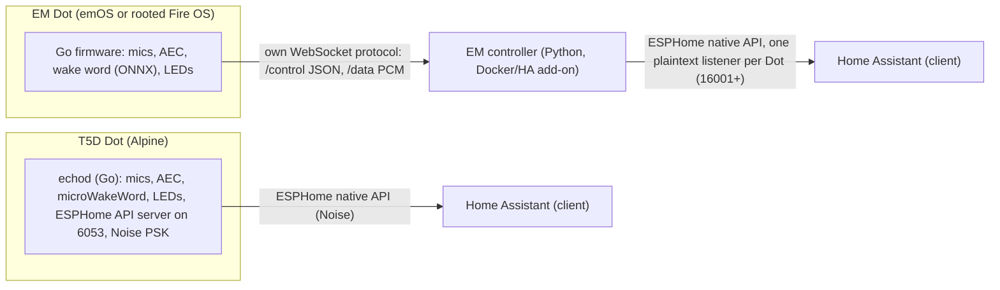

# R-08: Existing Echo Dot projects (EchoMuse, TECHO5 Dot, NEO)

Date: 2026-11-09 · Feeds: roadmap Phase B (B1-B6), ADR-0012, spec 0003 (REQ-SAT-011/013/014), NOTICE rules · Refines: [R-03](03-wake-word.md), [R-04](04-echo-dot-gen2.md), [R-05](05-wyoming-and-local-intents.md), [R-07](07-echo-dot-gen2-hardware.md)

Method: read-only study through the GitHub API on 2026-11-09 of the default branches of three public repositories (README, SETUP, CLAUDE.md files, `docs/`, `emos/`, `NOTICE` files, selected source files, release and issue lists). Nothing was cloned or run, no device was touched, and no code was copied. Paths below are relative to each repository; base URLs are `https://github.com/wilbowes/EchoMuse` (**EM**), `https://github.com/HuskerMinion/techo5-dot` (**T5D**), `https://github.com/HuskerMinion/techo5` (**T5**, the daemon source that T5D builds) and `https://github.com/techmiguel/neo-robot` (**NEO**). Claims I could not confirm from a primary file are marked **(unverified)**. Both Dot projects state that they were written largely with an AI assistant (EM `README.md` "How it's built"); that does not change the licence, but it means their prose is a record of what was tried, not independent proof, so I weight measured numbers and code over narrative.

## 1. Summary

1. **Two mature, active projects already do what R-07 and Phase B plan to do by hand, and they do it on the same unit**: both replace Amazon's software on the Dot 2 (`biscuit`), take all seven microphones, the LED ring, buttons, speaker and Wi-Fi, run a wake word on the device, and appear in Home Assistant as an **ESPHome voice satellite**. Neither is standalone: both need Home Assistant for speech recognition, intent and speech output (EM `README.md` "What it isn't"; T5D issue #40 shows a user stuck without HA).
2. **Neither speaks Wyoming** (no hit in either project's docs or sources). Their link to the "brain" is the **ESPHome native API**. In that protocol the Dot (or EM's controller impersonating a Dot) is the *server* and Home Assistant is the *client*. A non-HA brain such as ClawDot attaches by implementing the **client** side: dial the satellite, subscribe to the voice assistant, receive wake and audio, send events and speech back (section 4).
3. **That is feasible in Rust with no new dependency of note**: plaintext framing is trivial, and the optional Noise encryption (`Noise_NNpsk0_25519_ChaChaPoly_SHA256`) can be built on `ring`, which the lockfile already contains through rustls. Estimate 1,000 to 1,500 lines for a voice-only client **(estimate, not measured)**. T5D's Dot **requires** Noise; EM's per-device voice ports are plaintext.
4. **The Dot can be made to do announce-then-listen from outside**: the API has a client-to-device `VoiceAssistantAnnounceRequest` with `start_conversation`, and a `media_player` entity that plays a URL with an `announcement` flag. That is exactly ClawDot's inbox flow (speak the event, then listen for the reply). EM implements both (EM `controller/CLAUDE.md` "Announcements", "Announce-then-listen"); T5D claims announcements **(unverified in code)**.
5. **Our R-07 findings hold, and the projects close four of its unknowns**: the 9-channel capture map, the LED `frame` write format, how to autostart on Fire OS, and the audio ownership recipe (section 7). They also add hazards R-07 did not have (`calibrated_lux`, a boot-slot trap, mixer control ids that move between kernels).
6. **R-04's "no unlock is known" is obsolete**: R0rt1z2's `amonet` (v1.1.0 and v2.0.0, September 2026) unlocks retail `biscuit` over micro-USB, automated by `bboe/firebreak` (section 3.9). The roadmap B2 task "revisit R-04" is answered here.
7. **Licences are friendly**: all three repositories are MIT. Reuse is possible with notices, but almost nothing is worth *copying* (Go, C and Python against our Rust, plus HA-shaped designs). What is worth taking is **facts** (names, key codes, formats, sequences, hazards), the **ESPHome wire contract**, and a few **ideas** (section 6).
8. **Recommendation in one line**: stop trying to *be* the Dot's operating system. Make ClawDot the **brain** behind a Dot that runs one of these front ends (preferred base: TECHO5 Dot), by adding an ESPHome voice-satellite client to the core; keep our own board layer for the Pi, desktop and the existing Fire OS bring-up unit. Section 9 gives the revised Phase B.

## 2. The three projects

| | EchoMuse (EM) | TECHO5 Dot (T5D) with daemon T5 | NEO |
|---|---|---|---|
| What | Replaces the Dot 2 / Echo 2 software with its own Linux userspace **emOS** (or runs a Go firmware on rooted Fire OS 5), plus a **controller** (Python, HA add-on or Docker) that impersonates ESPHome voice satellites | Replaces Fire OS with an **Alpine Linux** image and one Go daemon (`echod`); the Dot itself speaks the ESPHome native API; supports Dot 2 `biscuit`, Echo 2 `radar`, Dot 3 `donut` | ESP32-S3 DIY voice assistant, own TinyML wake word, Python server (Whisper, Ollama or Groq, streamed TTS) |
| Licence | MIT, Wil Bowes (`LICENSE`) | MIT (`LICENSE`); `echod/` is MIT from EchoLocal (Yuri Gelfand) and T5 | MIT |
| Created / last push | 2026-05-01 / 2026-11-09 | 2026-09-16 / 2026-11-09 (T5: 2026-09-14 / 2026-11-09) | 2026-04-22 / 2026-10-31 |
| Size signals | 1,429 stars, 154 open issues, 30+ releases in three tag series (`v*`, `emos-v*`, `controller-v*`), 30+ contributors, Discord and subreddit | 238 stars (T5 600), 5 open issues, releases `dot-v1.0.x` roughly daily (v1.0.60 on 2026-11-09), 5 contributors | 1 star, 2 issues |
| Maturity (own words) | "runs daily on a small fleet"; emOS 0.11 "newer than FireOS and has fewer device-hours" (`README.md`, `emos/README.md`); UAT results kept (`docs/uat-results/`) | "in daily use on three units", Dot 2 tested on a bench unit, Dot 3 and Echo 2 "one unit so far" (`README.md`) | Single developer, measured results with raw data, Spanish only |
| Unlock | not included; uses `firebreak` (BSD-2-Clause) which runs R0rt1z2's `amonet` | not included; points to the same XDA threads | n/a |
| Standalone (no HA)? | **No** ("Not standalone", `README.md`) | **No** in practice: speech and setup need HA; the setup page opens only from HA (issue #40, open) | Yes (own server) |
| Relevance to us | High: hardware knowledge, ESPHome server code (`controller/esphome/`), wake-word forge, two years of hazards | Highest as a **base image**: no Android, signed A/B updates, rescue mode, Alpine armv7 userland | Low: ideas only |

Dependency chain worth knowing: EM credits Binozo's EchoGo and GoTinyAlsa; T5D credits EchoLocal (`ygelfand/echolocal`, MIT, 549 stars, active 2026-11-09), EM's emOS notes, and `ygelfand/go-esphome-device` (MIT, Go ESPHome SDK). The Dot knowledge in the three Dot projects is largely shared, which is also why their facts agree with each other (and with R-07).

## 3. How the Dot hardware is driven

### 3.1 Audio

| Item | Finding | Source |
|---|---|---|
| Capture | ALSA card 0 device 24 (`TLV320AIC3101 Capture`), the **only accepted format is 16 kHz, S24_3LE, 9 channels**. EM uses period 512 frames x 5 (160 ms ring) via GoTinyAlsa | EM `device/internal/bindings/mic/pcm_microphone.go`; T5D `docs/hardware.md` "Audio" |
| Channel map | ch0-5 = six perimeter mics on a 36 mm radius ring, ch6 = centre mic, **ch7/ch8 = digital loopback of the playback stream, L and R** (bit-exact zero when silent, taken before the volume control, mics lag it by about 33 samples and inverted) | EM `SETUP.md` "Mic Array Architecture"; T5D `docs/hardware.md` |
| Level | Speech is about -70 dBFS in the 24-bit sample; **truncating to the top 16 bits throws it away**, so apply gain (EM: +24 dB) before narrowing. T5D measured that its `>> 8` truncation costs under 0.1 dB SNR on its unit. The two projects disagree on the severity, so measure on our unit | EM `device/CLAUDE.md`; T5D `docs/microphones.md` |
| Playback | card 0 device 23 (`TLV320AIC3204 Playback`), **48 kHz, stereo, S16_LE**, period 2048 x 4 (EM). EM sends mono on the wire and duplicates L=R at the ALSA write | EM `device/internal/bindings/speaker/pcm_speaker.go` |
| Mixer | Resolve controls **by name, not by number**: FireOS 6's kernel has two more controls than FireOS 5's so every id after them shifts, and writing the wrong control succeeds. Mic gain: ADC_A..D digital volume 88, MICPGA 40 (Amazon's own init values); speaker path `HP Driver Gain Volume` (0..35, 6 = 0 dB for the speaker, 11 for the jack), `Ext_Speaker_Amp_Switch`, `Audio_DacMux_Setting`, 7-block `biquad coefficients` EQ blob | EM `docs/boards.md`, `SETUP.md` "Audio Notes"; T5D `docs/hardware.md` |
| Without Android | Both directions clock with **no HAL, no mediaserver, no framework**, but then **nothing opens the codec's DAPM routes**: mics and speaker stay powered down until userspace sets the mixer. The speaker amp idles on and hisses; gating it clicks, so EM plays a silence stream | EM `emos/README.md` "Why"; T5D `docs/hardware.md` |
| Fire OS contention | `stop media` and `stop mixer` only get out of the way "for a moment": Android restarts them, and **EM wins the device once and holds it for the process lifetime**. Holding mediaserver down permanently makes things worse (it publishes AudioFlinger; denying it crash-loops `system_server`, which owns WifiService; mic stalls doubled, `wlan0` vanished twice). The HAL also rewrites mixer values every 60-90 s on a jack event | EM `SETUP.md` "Audio Notes" |
| Never | Do not run `tinyplay` while the server holds the PCM (wedges the device); do not `unbind` a driver (the next read hangs until power cycle) | EM `device/CLAUDE.md`, `docs/boards.md` |

**Hardware echo reference is real**: ch7/ch8 let AEC use a bit-exact reference with no delay search (EM `device/CLAUDE.md` "AEC", SpeexDSP-based; measured about 27 dB cancellation on the Dot 3 with its own loopback PCM). No hardware AEC or beamformer exists (R-07 section 6 holds); both projects run AEC in software, and both found delay-and-sum on the 72 mm ring gains nothing, so they use a centre-mic or seven-mic average (T5D measured +1 to +2.5 dB for the average, `docs/microphones.md`).

### 3.2 LED ring

- Hardware: ISSI IS31FL3236 at I2C `0-003f`, 12 RGB LEDs, sysfs under `/sys/bus/i2c/devices/0-003f/`: `frame`, `led_current`, `boot_animation` (EM `device/internal/bindings/led/i2c_controller.go`; T5D `docs/hardware.md`). Both projects locate it **by driver name** `is31fl3236`, never by bus number.
- **The `frame` write format (R-07 unknown 2, now answered)**: one write of **12 x 6 ASCII uppercase hex characters, `RRGGBB` per LED (72 bytes)**, LED index 0..11 in order (EM `device/pkg/led/led.go` `BuildArgument`, `i2c_controller.go` `SetLEDs`). Brightness is the LED's value and `led_current`; EM writes `3` to `led_current` and `0` to `boot_animation`. Under emOS `frame` reads back exactly what is displayed (EM `emos/README.md` "The handover").
- **Ownership**: EM runs `stop ledcontroller` at init (`Init()`), and on FireOS 6 kills only the controller's PID (`start_server.sh`, issue #1002 in `JOURNAL.md`). That is our route B working in practice. T5D's FireOS-6 EchoLocal install actually *replaces* `/system/bin/ledcontroller` with the daemon (`docs/hardware.md` "First unit").
- Geometry: LED 0 is physically at 240 degrees (just clockwise of MK5); `LED = ((angle - 240 + 360) % 360) / 30` (EM `SETUP.md`). The kernel's own boot animation (blue ring, one cyan head, 109 ms per step) runs until userspace clears `boot_animation`.
- Pattern vocabularies: EM has a documented state ladder (`docs/led-ring-states.md`: volume arc, mute red, link-state orange pulse, turn animations `solid/spin/rotate/pulse/meter`, direction overlay), T5 has a priority ladder (`echod/internal/hardware/led/driver.go`: base, room, mute, timer, busy, turn, alarm, notice, trouble, boot). Both express *outcomes by rhythm, not colour*, and one meaning per signal (EM `docs/led-ring-states.md` section 1). This is useful input for REQ-BRD-006.
- Stock `.animation` files and `ledctrl` are **Amazon's**. EM's rule: "Do not carry Amazon's files. Read values off your own device and put the numbers in the description" (`docs/boards.md`). Our route A (preloaded patterns) therefore depends on files we may not ship, which is another reason route B (own the ring) is the better long-term path.

### 3.3 Buttons and mute

- evdev, found **by device name**: `mtk-kpd` (keypad, carries mute 113 and action 138 `KEY_HELP`) and `keys` (GPIO keys, volume 114/115); on the Dot 3 `gpio-keys` plus `gpio-privacy` (EM `docs/boards.md`). Codes: 113 mute, 114 vol-, 115 vol+, 138 action (EM `device/pkg/buttons/button.go`; T5 `echod/internal/hardware/buttons/codes_dot.go`). This **closes R-07 unknown 1 for the code-to-meaning mapping**; only which physical press arrives on which node remains, and EM resolves it by key code, not by device (both input devices advertise volume-down, only one sends it).
- Long-press classes are computed in userspace from down/up times; EM stops Amazon's `acebutton` (FireOS 5) and `acebuttond` (FireOS 6) so Amazon does not also act. Holds: EM pairing hold 5 s (7 s on plain links); amonet recovery combos use mute (v1.1.0) or volume up (v2.0.0) at power-on (EM `docs/rooting.md`).
- **Mute is a software mute**: EM sets the ADC mute controls on all four codec chips (`SETUP.md` "Mute implementation", controls 105/106, 123/124, 141/142, 159/160 on its kernel), refuses to listen while muted, and states "the Dot 2 has no hardware switch that disconnects them" (`README.md` "Privacy"). T5D's table says "Mute is the hardware mute line" (`README.md`) but its code path (`echod/internal/hardware/privacy/`) and R-07 section 4 do not prove it. **Our `software` declaration (REQ-BRD-008) stands**; do not repeat T5D's wording.
- Mute LED: sysfs GPIO 444, active high, on the Dot 2 (Amazon's HAL constant 445 is off by one). **On the Dot 3 GPIO 444 is an audio clock and exporting it silences the amplifier until reboot** (EM `docs/boards.md` caveats). On FireOS 6 the mute LED belongs to `amz_privacy`, which "boots unmuted, can enter privacy but never leave" (EM `device/CLAUDE.md`).

### 3.4 Wi-Fi

- Chip: MediaTek CONSYS (MT6625L RF), kernel built in; under Android it is brought up by Amazon's `wmt_loader`/`wmt_launcher`. **Without Android both projects bring the chip up themselves**: ioctls on `/dev/stpwmt` (`SET_PATCH_NAME`, `SET_STP_MODE` with HIF `0x23` for biscuit), then a loop answering the driver's `srh_patch` requests; patch download order runs **backwards** through sorted names; firmware is found through `/etc/firmware` (EM `emos/README.md` "WiFi"; T5D `cmd/wmtup/`). Own static `wpa_supplicant` 2.10 plus busybox `udhcpc`; **no SAE, so no WPA3** on the Dot 2.
- On Fire OS: use `wpa_cli -p /data/misc/wifi/sockets -i wlan0`; **two `wpa_supplicant` processes can fight** (the bare init service and the framework one); the only reliable reload is `svc wifi disable` then `enable`; `wifiprofilemanager` and `SmartHomeWifid` re-assert Amazon's saved profile and must be disabled (EM `JOURNAL.md`, 2026-07 entries). This answers R-07 unknown 7: a `wpa_cli` join **does** get overridden unless Amazon's managers are disabled, and `update_config=1` persists it.
- DHCP/clock without Android: busybox `udhcpc` with a lease script; **bionic binaries have no DNS without Android's property service**, Go and musl binaries do (EM `emos/README.md` "Known gaps"; T5D `docs/hardware.md`). Good news for a musl Rust binary.
- Shared antenna: Wi-Fi and Bluetooth share it; a BLE scan costs the AP 47-150% frame resends (EM `device/CLAUDE.md`). Relevant only if we ever add a BLE proxy; we should not.

### 3.5 Clock

R-07 unknown 8 ("reliable synced signal"). EM: the RTC reads 2010 and the controller **pushes the time over its authenticated link** (`ack` field `time_ms`), because bionic `ntpd` cannot resolve names (EM `emos/README.md` "Known gaps"). T5D: NTP by IP or gateway (`docs/hardware.md`). Both agree with R-07 that the platform has no trustworthy time on its own. For us the answer is the one R-07 already leaned to: a **core-side HTTPS `Date` check** (REQ-TMR-009), or on a managed base, time pushed by the host.

### 3.6 Boot and autostart (R-07 unknown 9, answered)

| Base | How the app starts |
|---|---|
| Fire OS 5 + root (EM "FireOS" flow) | One write to the boot partition (`mmcblk0p10`): adds `androidboot.selinux=permissive` to the cmdline and **appends a `service echomuse /data/local/bin/start_server.sh` block (and a dummy `mixer` service so `stop mixer` succeeds) to `init.csm.project.rc` in the boot ramdisk** (EM `docs/rooting.md`, "Patch Boot Image"). The service lives in `/data`, so updating it never touches `/system`. A Magisk `service.d` script is the alternative for daemons that must be re-stopped after boot (EM `JOURNAL.md` 2026-07-18 debloat) |
| EM emOS | Amazon's kernel + EM's static PID 1 (`emos/init/init.c`, about 500 lines of C) + busybox, with bionic and tinyalsa mounted read-only from the device's own `/system`; cold boot to network about 32-35 s; A/B rollback via `/data/emos/boot-good.img` and a boot-confirmed counter (`emos/README.md`) |
| T5D | Alpine armv7 rootfs (about 49 MB), PID 1 `tools/linux/init` under static busybox; the kernel image is built from Amazon's GPL source with Bluetooth enabled; two root-filesystem slots with trial boots and automatic rollback; **boots from the recovery partition**, leaving Fire OS in the boot slots (`docs/porting-plan.md` "It goes in the recovery partition"). 45 s from reboot to the HA API, 21 s to Wi-Fi |

Fire OS 6 detail: a stock boot slot image carries `skip_initramfs`, so a custom ramdisk in a boot slot is silently ignored; this is why T5D uses `recovery` (`docs/porting-plan.md`).

### 3.7 How Alexa is removed

- **EM on Fire OS 5**: `pm disable` for 12 packages (`runDisableAlexa`), then a "debloat" step that `pm hide`s a canonical 31-package list (FireOS 5 ignores `pm disable` for persistent system apps) and re-stops native daemons (`vitals_service`, `perfmonitord`, `perfrecoveryd`, `shblemeshd`, `meshmgrservice`, `drm`) 45 s after each boot via `service.d` because `stop` does not persist. Measured: -130 MB RAM, no voice regression (EM `JOURNAL.md` 2026-07-15/18). `SmartHomeWifid` needs `persist.wifi.migrate.complete 0`, not a package disable. **The debloat list is a data file in `controller/device_payloads/debloat_packages.txt`**: facts we can reread from our own unit rather than copy.
- **emOS / T5D**: Android is not started at all, so nothing needs removing; the cost is that every Android service you used (Wi-Fi, audio routes, time, LED, buttons) must be reimplemented (sections 3.1-3.5). Both report that the reimplementation was *thinner than expected in surface and thicker in depth* (EM `emos/README.md` "Why": the HAL had silently configured the codec routes).
- R-07 section 9's hypothesis list (telemetry, OTA, voice stack, then `mixer`/`dacd` last) is consistent with this, but note that the EM material I read does not stop `pwrsvcd` or the thermal daemons, matching R-07's "do not" row, and that `perfrecoveryd` is among the daemons its debloat re-stops on FireOS 5 without a reported reboot (behaviour on FireOS 6.5.7.5 is **unverified**).

### 3.8 Brick and recovery risk

- The unlock is the dangerous part and belongs to R0rt1z2's `amonet`; EM states the two rules that matter: **"Stop trying to boot it. The preloader tracks boot attempts per slot, and if both slots run out of attempts the device stops booting"**, after which recovery means **opening the case and shorting a test point** (EM `docs/rooting.md` "If a device will not boot"; T5D `docs/hardware.md` "Brick recovery").
- `amonet` v2.0.0 (2026-09-10/11) **rewrites the bootloader chain** (older `tz.img`, stock `lk`, downgraded preloader) and **FireOS 5 no longer boots after it**; v1.1.0 keeps FireOS 5. T5D and EM both warn against going back from v2 by flashing older bootloaders (`docs/hardware.md`, `docs/rooting.md`).
- Both keep **escrow backups of every boot-critical partition** md5-verified against the device before any change (T5D installer step 1; EM wizard step 3), and a `dd` of the escrowed boot image restores a failed emOS in about ten seconds. A `dd` can complete at page-cache speed and be lost: write with `conv=fsync`, `drop_caches`, then read back (EM `emos/README.md` "Flashing safely").
- Avoid connecting a stock Echo to Wi-Fi before the unlock: Amazon can update it to a build the unlock does not support (`firebreak` README "Quick start").
- OTA: nothing in either project proves an OTA is blocked; EM disables OTA-related packages only as part of its debloat **(unverified for OTA specifically)**. Keep R-07's rule: stop `otad`/`ace_otad` before trusting an unlocked unit.

### 3.9 Unlock status (R-04 correction)

R-04 concluded "no unlock known for retail units". Since then `amonet-biscuit` (v1.1.0, then v2.0.0 on 2026-09-10) has been published on XDA by R0rt1z2 and is automated by `bboe/firebreak` (BSD-2-Clause, 77 stars, last push 2026-11-09): `uvx firebreak@latest unlock`, over the Dot 2's micro-USB port, no case opening for the Dot 2. The Echo 2nd gen and Dot 3 need soldered USB pads (T5D `README.md`). `amonet`'s repository carries `LICENSE.GPL2` and `LICENSE.MIT` side by side (per file; I did not map which is which). **Neither project redistributes the unlock.** A correction note belongs on R-04 (section 10). The history and mechanism of the unlock are written up separately in [R-09](09-echo-unlock-history.md).

## 4. How audio and wake word reach the brain

### 4.1 Architecture of each

- **EM** has two hops. The Dot speaks a private three-plane WebSocket protocol to the controller (`/control` JSON with capability negotiation, `/data` binary frames `0x01` mic PCM mono S16_LE 16 kHz and `0x02/0x03` speaker PCM, `/shell`; TLS and token on 8770; mDNS `_emcontroller._tcp`; `docs/device-controller-interface.md`). The controller "impersonates ESPHome voice satellites" (`controller/CLAUDE.md` "Voice backend"): one TCP listener per Dot, plaintext (`controller/esphome/satellite_server.py` is plaintext-only; `noise.py` is used for the Bluetooth proxy connections only), vendoring `aioesphomeapi` 45.3.1 protobufs.
- **T5D** has one hop: `echod` is the ESPHome server on the Dot (port 6053; `echod/internal/feature/api/api.go`). It serves **Noise only** when a key is installed, answers a plaintext hello with ESPHome's own handshake rejection (`plainhint.go`), and runs "unprovisioned" with the reserved all-zero PSK so HA can push a real key (`loadPSK`). It reports a recent `ESPHomeCompat` version to keep HA's repair notices away (`compat.go`).
- Wake word: EM runs **openWakeWord** models in ONNX Runtime on the device (about 23% of one core with `embedding_stream.onnx`), or on the controller; T5 runs **microWakeWord** TFLite models through a pure-Go interpreter (`echod/third_party/microwakeword`, about 30% of one core on the bench unit, `README.md`). Both send nothing before the wake word by default ("private listening", EM `docs/listening.md`).

### 4.2 What a non-HA brain must implement (client side)

Verified against `esphome/aioesphomeapi` (MIT, `api.proto`, `client.py` `subscribe_voice_assistant`), which is the library HA uses:

1. **Transport and framing**: TCP to 6053 (or EM's per-device port). Plaintext frame: `0x00`, varuint payload length, varuint message type, payload. Noise frame: `0x01` plus a 16-bit length, handshake `Noise_NNpsk0_25519_ChaChaPoly_SHA256` with the device's 32-byte base64 PSK, our side the **initiator** (`api.proto` `noise_encryption_set_key`; EM `controller/esphome/noise.py` is the responder half, written from the Noise spec rev 34 with a warning that omitting the `e` token's `MixKey` "still handshakes with itself", so use published vectors).
2. **Handshake**: `HelloRequest` (id 1) / `HelloResponse`, `DeviceInfoRequest` (reports `voice_assistant_feature_flags`: bits `VOICE_ASSISTANT 1, SPEAKER 2, API_AUDIO 4, TIMERS 8, ANNOUNCE 16, START_CONVERSATION 32`), `ListEntitiesRequest` (to find the `media_player`, light and switch entities; EM notes HA ignores a device with zero entities, which does not bind us), `PingRequest`.
3. **Voice**: `SubscribeVoiceAssistantRequest` (id 89) with flag `API_AUDIO` (1). The device then sends `VoiceAssistantRequest` (id 90: `start`, `conversation_id`, `flags` USE_VAD/USE_WAKE_WORD, `wake_word_phrase`) and `VoiceAssistantAudio` (id 106, **16 kHz S16 mono**, `end` flag). We reply `VoiceAssistantResponse` (id 91, `port = 0` for API audio) and drive the UI with `VoiceAssistantEventResponse` (id 92: `RUN_START, STT_START, STT_VAD_START/END, STT_END, INTENT_START/END, TTS_START, TTS_END, RUN_END, ERROR`). Speech back: either a URL in `TTS_END` data that the Dot fetches, or `VoiceAssistantAudio` frames toward the device (`TTS_STREAM_START/END` events, sentence by sentence) **(exact audio format and rate for the API-audio return path are unverified; read aioesphomeapi and EM `em_esphome.py` before writing code)**. `VoiceAssistantRequest(start=false)` is the abort.
4. **Push from ClawDot (the inbox)**: `VoiceAssistantAnnounceRequest` (id 119: `media_id` URL, `text`, `preannounce_media_id`, `start_conversation`), answered by `VoiceAssistantAnnounceFinished` (id 120) when playback really ends; or `MediaPlayerCommandRequest` (id 65: `media_url`, `announcement`, `volume`). Both need an HTTP URL the Dot can reach, which the core already serves.
5. **Optional**: `LightCommandRequest` (id 32) for ring effects where `echod` exposes a light entity (T5D `README.md`: "the ring is a configuration entity"); `VoiceAssistantSetConfiguration` (id 123) to select the active wake word.

Not needed: authentication (removed in ESPHome 2026.1, `api.proto` comment), Bluetooth proxy, camera, climate and the other entities.

### 4.3 Effort and fit

| Piece | Rough size | Notes |
|---|---|---|
| Frame layer (plaintext + Noise record) | 200 lines | Nothing else is needed on the wire |
| Noise NNpsk0 initiator | about 200 lines on `ring` (X25519 agreement, ChaCha20-Poly1305, HMAC-SHA256 as the HKDF) | `ring` is already a transitive dependency of rustls; **no `snow` crate needed (unverified until built)**. Test with Noise spec vectors and the real `aioesphomeapi` as peer |
| Protobuf codec for about 20 messages | 300 lines hand-written | The workspace has no `prost` in `Cargo.lock`; avoiding it keeps the budget. Field numbers are protocol facts from `api.proto` |
| Voice session driver (events, TTS return, announce, abort, reconnect) | 400-600 lines | Mirrors our existing voice dialog state machine; EM `controller/CLAUDE.md` lists the sharp edges (RUN_END without RUN_START, HA-side VAD never engaging, announce while a turn is running) |

Total about 1,100 to 1,300 lines **(estimate)**, as an optional feature that does not enter the default Dot build budget unless chosen.
**Server side, the other direction** (ClawDot pretending to be an ESPHome device so a satellite dials *us*, as EM's controller does for HA): not useful for us, because the Dots in question are already servers, and the real satellites (Voice PE, Atom Echo, linux-voice-assistant) are also servers. We would only need it to make ClawDot show up inside HA, which is the Phase C/`HACS` item, not Phase B.

### 4.4 Wyoming

Neither Dot project has a Wyoming satellite mode. Wyoming remains relevant for Raspberry Pi satellites and the existing `wyoming-satellite` ecosystem (R-05), so REQ-SAT-014 stays as is, but **for the Dot, ESPHome is the integration surface**. Our own protocol keeps its Wyoming-compatible framing (REQ-SAT-011).

### 4.5 Can ClawDot attach without HA, and what does it cost?

| Route | Needs | Result | Cost / risk |
|---|---|---|---|
| ClawDot dials **T5D Dot** directly (`dot:6053`, Noise PSK) | PSK from the Dot's key file; client implemented in section 4.2 | No HA, no controller, no extra computer. The Dot supplies AEC, mic averaging, wake word, ring, buttons, Wi-Fi, updates | Couples us to `echod`'s HA-shaped assumptions: **single voice subscriber (unverified)**, setup page opens only from HA (issue #40), wake-word selection through HA configuration, timer/alarm features live in the daemon. We must test whether `echod` runs its voice turn with no HA conversation partner |
| ClawDot dials **EM controller** per-device port | EM controller running (Docker) and the Dot approved in its dashboard | Works with the EM ecosystem | Requires an always-on host running a Python service and a dashboard step; heavier than our "tiny, standalone" story. Plaintext port is LAN-only |
| ClawDot runs **on the T5D Dot** itself, dialling `127.0.0.1:6053` | static armv7 musl binary into the Alpine rootfs; a service entry | Single-box product, closest to the "Dot as the appliance" goal | Memory is fine (445 of 481 MB free with everything running per T5D, ClawDot budget 64 MB hard gate); `echod` still owns the audio devices, so ClawDot never opens ALSA |
| ClawDot **replaces `echod`** on the T5D rootfs | our own board layer and audio crate on Alpine | Full control, no Go daemon | Re-does AEC, wake word, LED ring, BT, Wi-Fi tooling that already exist; this is the old Phase B3-B5 plan on a better OS |

## 5. Co-residence: can the Rust binary run *on* their userspace?

- **Binary compatibility**: yes on T5D (Alpine armv7 musl; our target `armv7-unknown-linux-musleabihf` already runs on the Fire OS 6 unit per R-07). On EM's emOS the userland is **bionic from the device's own `/system`**; static musl binaries are fine, and Go binaries are used for DNS reasons, which a musl Rust binary also avoids (EM `emos/README.md`).
- **Audio device contention**: the ALSA PCMs are single-open and the project that owns them (`echod`, or EM's firmware) holds `pcmC0D24c` and `pcmC0D23p` for the life of the process; EM never uses `tinyplay` beside it because it "wedges the device". So **two audio front ends cannot coexist**. Either `echod`/EM firmware is the front end and ClawDot is a client of it (section 4), or `echod` is stopped and ClawDot takes the devices, owning codec routes and the silence stream (the work that EM spent weeks on). This is the same "device ownership, not capability" conclusion as R-07 section 12.
- **Other contention**: the LED ring (`frame`) and the evdev nodes can be shared (evdev allows several readers), but a second writer to `frame` produces torn frames (EM serialises all writers behind one mutex). The Wi-Fi supplicant and the firewall belong to the base.
- **Firewall**: T5D drops inbound traffic except named ports (README "Locked down"), so a ClawDot listener on the Dot needs a rule; EM's emOS has INPUT DROP (mDNS responses must be allowed or the device never finds its controller). This is the same hazard as the roadmap B2 "Amazon iptables" note, on a different base.

## 6. Licences and reuse rules

ClawDot is Apache-2.0 (`NOTICE`, `LICENSE`). MIT code may be reused or ported **with the copyright line and permission notice kept** in the file or in `NOTICE`. An entry in `NOTICE` is required for anything we copy or port, naming the source repository, commit, files, copyright holder and licence. Facts (a register, a key code, a sequence, a format, a hazard) are not copyrightable, but credit the finder in docs. We have copied **nothing so far**; no `NOTICE` change is needed for this note.

| Component | Licence (evidence) | What it is | Action |
|---|---|---|---|
| EM own code (Go firmware, Python controller, C `init.c`) | MIT, Wil Bowes (`LICENSE`) | Hardware bindings, controller, PID 1 | **Learn** (facts into docs and the board file). Copying is not sensible: Go/C/Python against Rust, and designs tied to their controller |
| EM `device/pkg/board/hardware.go`, `testdata/` fixtures | MIT | Names of parts per board | **Learn**; the fixtures are Dot output and our unit gives the same, so regenerate our own as test data |
| EM `controller/esphome/noise.py`, `frame_protocol.py` | MIT | Noise responder, frame layer | **Learn** (algorithm, test strategy); write the initiator in Rust. Port only a small helper if it saves real time, with notice |
| EM `controller/esphome/vendor/` (generated from aioesphomeapi) | MIT, Otto Winter (`NOTICE.md`) | Generated protobufs | **Do not copy generated Python**; use `api.proto` from `esphome/aioesphomeapi` (MIT) as the reference. If we vendor the `.proto` file, keep the MIT notice and add a `NOTICE` entry |
| `esphome/esphome` main repo | GitHub reports `NOASSERTION` (mixed licences) **(unverified)** | The firmware framework | **Do not copy** from it; read only. Use `aioesphomeapi` (MIT) |
| EM `oww_forge/` | MIT; its pinned upstreams carry their own terms (`NOTICE.md`) | Trainer for custom openWakeWord models (uses Piper-generated speech) | **Depend (external tool, not bundled)** for the future "ClawDot" wake word, after reading its pins (Piper voice licences unverified) |
| `GoTinyAlsa` (EM submodule, BSD-3-Clause, binozoworks) | BSD-3-Clause | Go binding to libtinyalsa | **Learn** (parameters: 16 kHz S24_3LE 9 ch, period 512 x 5; 48 kHz S16_LE stereo, period 2048 x 4). We spawn `tinycap`/`tinyplay` (A2), so no copy |
| SpeexDSP AEC (vendored in EM `device/internal/aec/`) | BSD-3-Clause, Xiph.Org et al. | Echo canceller | **Depend later, not now**: C code, so it needs FFI (`unsafe`), which the workspace forbids. If ever wanted, as a separate sidecar process, with the BSD notice. Revisit with the Phase C barge-in opt-in |
| ONNX Runtime (EM dlopen), DTLN models | MIT | Inference, noise suppression | **Avoid** in the default build (size); DTLN is an optional controller-side idea only |
| Home Assistant Voice PE timer sound (EM `controller/sounds/`) | CC BY 4.0, Clayton Charles Tapp | Sound | **Avoid**; make our own earcons |
| T5D / T5 own code (`echod`, installer, init, `cmd/wmtup`) | MIT (`LICENSE`); `echod` MIT from EchoLocal (Yuri Gelfand) | Daemon, installer | **Depend** on the *running product* (as the supported front end), not on its source. **Learn** from `cmd/wmtup` and `tools/linux/init` if we ever build our own image |
| T5 `echod/third_party/microwakeword` | MIT, Serge Zaitsev (`zserge/microwakeword`, 1 star); derived pieces carry Apache-2.0 (microWakeWord front end, Google/ESPHome) and BSD-3 (kissfft-style FFT, Mark Borgerding) per `NOTICE` lines 60-70 | Pure-Go streaming microWakeWord runtime | **Learn** as the best existing reference for SPIKE-002 (a TFLM-free runtime). A Rust port is legitimate **but must carry three notices** (MIT, Apache-2.0, BSD-3-Clause); decide only after the spike |
| `esphome/micro-wake-word-models` (okay_nabu, hey_jarvis, hey_mycroft, alexa) | Apache-2.0 including weights (repo licence; T5 `NOTICE` "Wake word models") | Pretrained models | **Depend / bundle with provenance** is allowed by REQ-VOI-009. Avoid the **"alexa"** model on trademark and product-confusion grounds, not licence |
| `fwartner/home-assistant-wakewords-collection` (computer, jarvis, glados, ...) | MIT for the repository, but "records no separate license, author or training data for each model" (T5 `NOTICE`) | Community wake words | **Avoid shipping**: fails our provenance rule (REQ-VOI-009) |
| openWakeWord code | Apache-2.0 | Wake-word library | Usable code; **pretrained models are CC BY-NC-SA 4.0** (`dscripka/openWakeWord` README, "License"), so never bundle them (R-03 confirmed; T5 deliberately ships none of the six) |
| Piper | Original `rhasspy/piper` MIT but **archived**; active successor `OHF-Voice/piper1-gpl` is **GPL-3.0** | TTS | **Avoid linking** into the Apache core; a separate process is acceptable; each voice has its own licence **(unverified)** |
| Linux kernel for the Dot (T5D builds from Amazon's GPL source) | GPL-2.0; T5D publishes the kernel binary and patch scripts with source; EM ships only an init and **never an image** because an image contains Amazon's kernel | Kernel | **Never redistribute** a boot image or kernel ourselves. If a user installs T5D, they get its GPL release from T5D. If we ever document a build, give the recipe, as both projects do |
| busybox (built by EM and T5) | GPL-2.0 | Userland | Separate programs; EM attaches source and licence to releases. Not relevant unless we ship an image |
| Amazon files (`audio_device.xml`, `.animation` files, `AFE.cfg`, firmware blobs) | Amazon's | Tuning, patterns | **Never copy or ship**; read values off the user's own unit at runtime, as EM does for the radar filter (`docs/boards.md`) |
| `amonet` / `kaeru` / TWRP tree (R0rt1z2) | `LICENSE.GPL2` and `LICENSE.MIT` in the repo root | Unlock | **Do not redistribute**; link to the XDA thread and `firebreak` (BSD-2-Clause) in the install guide |
| NEO code, firmware, server | MIT | ESP32 assistant | **Learn** (section 8); nothing to copy. Its TTS default `edge-tts` drives a Microsoft web endpoint without an official API (terms-of-service risk, **unverified**) and must not become our default |

Rules for ClawDot contributors, concrete:

1. Do not paste code from any of these repositories without a `NOTICE` entry (project, commit, files, copyright, licence) and the original header kept. Prefer re-deriving from the protocol spec or the hardware.
2. Record hardware facts with their source and the number of units they were read from (EM `docs/boards.md`: "One unit is one data point").
3. Never commit Amazon-originated files, calibration data, or serial/MAC data.
4. Models: only with recorded provenance and a compatible licence (REQ-VOI-009). Never bundle CC BY-NC-SA weights.
5. Anything GPL stays a separate process or a user-installed base, never linked into the core.

## 7. Overlap and conflict with R-07 and Phase B

### 7.1 R-07 findings: confirmed, contradicted, answered

| R-07 finding | Verdict | Evidence |
|---|---|---|
| Platform: MT8163, 4 x A53, ~477 MiB, armv7 userland, kernel 3.18.19, `armv7-unknown-linux-musleabihf` is right | **Confirmed** | T5D `docs/hardware.md` (489,068 kB MemTotal on its unit, 3.18.19 32-bit); EM `emos/README.md` |
| Input: `event1` = `mtk-kpd` {113, 114, 138}, `event2` = `keys` {114, 115}; codes 113/114/115/138 | **Confirmed**; resolve **by name** | EM `docs/boards.md`; T5 `codes_dot.go` |
| LED: IS31FL3236 at `0-003f`, 12 RGB, `frame`/`led_current`/`boot_animation` | **Confirmed**; `frame` format **answered** (12 x `RRGGBB` ASCII hex, section 3.2) | EM `led.go`, `i2c_controller.go` |
| Audio: capture `pcmC0D24c` 9 ch 16 kHz S24_3LE, playback `pcmC0D23p` 48 kHz stereo S16_LE | **Confirmed** | EM `pcm_microphone.go`, `pcm_speaker.go` |
| R-07 unknown 5: 9-channel map | **Answered**: ch0-5 mics, ch6 centre, **ch7/8 hardware playback loopback** | EM `SETUP.md`; T5D `docs/hardware.md` |
| Capture is single-open and held by `mixer`; Amazon's audio stack must be stopped | **Confirmed and refined**: `stop mixer`/`stop media` are temporary; hold the PCM once; do not leave mediaserver down | EM `SETUP.md` "Audio Notes" |
| "Mixer setup from `audio_device.xml`" | **Confirmed**, plus: DAPM routes are not opened without Android | EM `emos/README.md` "Why" |
| Mute: privacy driver, electrical effect unprovable | **Confirmed**: EM treats it as ADC software mute and says no hardware disconnect | EM `README.md` "Privacy" |
| `power_button_state` panics | **Confirmed** by T5D ("crashes the kernel, the watchdog reboots"); EM says it "blocks the console" on FireOS 6 | T5D `docs/hardware.md`; EM `device/CLAUDE.md` |
| R-07 section 11 item 11: reading `calibrated_lux` is "nothing risky" | **Contradicted**: EM's current rule is **never read `calibrated_lux`** on the TSL2584 (kernel corruption; frees a pointer `strsep` moved) and read `illuminance0_input` only when idme `alscal` contains `ams_0_0`. EM's own earlier journal entry read it successfully on another unit, so treat as **forbidden until proven safe on ours** | EM `device/CLAUDE.md`, `JOURNAL.md` (#1008 entry) |
| Clock stale after reboot, RTC 2010 | **Confirmed**; both projects push or fetch time themselves | EM `emos/README.md`; T5D `docs/hardware.md` |
| Wi-Fi: `wpa_supplicant` control socket works | **Confirmed**, with the two-supplicant and Amazon-manager override hazards (unknown 7 answered) | EM `JOURNAL.md` |
| Unknown 9: autostart | **Answered** (boot ramdisk `init.csm.project.rc` service block, or Magisk `service.d`) | EM `docs/rooting.md` |
| Unknown 10: unlock and OTA | **Answered** for unlock (amonet via firebreak); OTA survival **still unverified** | section 3.9 |
| Hazards table | **Extended** with: `calibrated_lux`; unbinding drivers; `tinyplay` beside a holder; GPIO 444 on other boards; boot-slot ramdisk trap (`skip_initramfs`); multiple power cycles after a failed boot | sections 3.3, 3.6, 3.8 |
| Ownership, not capability, is the hard part | **Strongly confirmed**; it is also the reason both projects ended up replacing Android | EM `SETUP.md`, `emos/README.md` |
| Fire OS 6.5.7.5, userdebug, dm-verity disabled | **Consistent with** the amonet v2 / EchoLocal boot images (T5D bench unit: `boot_b` identical to EchoLocal's `boot.img`, `androidboot.selinux=permissive`); **how our unit was unlocked remains unknown** to this note | T5D `docs/hardware.md` "First unit" |

### 7.2 Overlap with Phase B

| Roadmap step | Overlap | Assessment |
|---|---|---|
| B1 Board crate (Board trait, NullBoard, desktop, JSON data files, auto-detect) | Both projects reached the same design independently: parts found **by name**, per-board data not branches (`TestNothingBranchesOnBoardIdentity`), detection by Amazon product id from `/proc/idme/device_type_id` (the device tree cannot tell MT8163 products apart, EM `docs/boards.md`), "ambiguous is refused, never first match" | Strong validation of ADR-0012. **Add `/proc/idme/device_type_id` and name-based resolution to the `detect` rules** |
| B2 Dot 2 build, autostart, install guide | Autostart is answered (3.6). The install guide is largely "run firebreak, then run T5D's installer (or EM's wizard)" | Becomes a short guide; the large part (our own installer) disappears |
| B3 Audio, buttons, LED on the Dot | The part most duplicated: EM and T5 spent months on AEC, DAPM routes, silence stream, ring ownership, thermal/CPU parking (`applyCoreFloor`, HPS) | **Cut for the Dot** if a base owns the hardware; keep the trait for Pi/desktop |
| B4 Wi-Fi, clock, mute | Wi-Fi without Android is solved by both bases; clock is pushed or NTP; mute is software | Folded into "base image" choice |
| B5 Staged Alexa removal | Solved by not running Android (bases) or by EM's debloat recipe (Fire OS 5) | Replace with "adopt a base; do not write a removal procedure" |
| B6 Pi board | Unaffected | Keep |

### 7.3 Conflicts to watch

- **Naming and branding**: T5D's wake-word list includes "Alexa" and "Okay Nabu"; we keep our own word out of v1.0 (A3).
- **Our `unsafe_code = "forbid"` and static budget** versus their heavy daemons (`echod` is an 18.7 MB binary on the T5D bench unit per `docs/hardware.md`; EM adds a Python controller). They do not conflict with *using* them, only with *copying* them.
- **Their HA coupling** versus our standalone promise: a Dot behind T5D is standalone only if `echod` tolerates a non-HA client; this must be tested (section 9, B0).

## 8. NEO: ideas only

NEO (MIT, 1 star, 2 issues) is an ESP32-S3 project with a Spanish-only TinyML wake word ("Hola NEO", 15 KB int8 CNN, 95.7% test accuracy on two speakers, not reusable for us), Whisper, Ollama or Groq, and edge-tts. Ideas worth taking, all already in our specs or roadmap:

- **Sentence-level streaming TTS**: cut LLM tokens into phrases, synthesise each and start playing after about 256 ms of buffered audio (`docs/streaming-latencia.md`, measured saving about 1.9 s once answers split). This is our A4 requirement; use their measurement method (latency from end of recording to first audio, median and p90, 31 phrases) as a template for our benchmark.
- **Intent without the LLM**: keyword intent detection answers weather, prices and greetings without a model (faster, cheaper, no hallucination): our REQ-AST-010 fast path.
- **Prerecorded failure phrases** ("server unreachable", "no internet", "didn't understand") so the device can speak when the brain is gone: relevant to our offline/degraded states on a Dot with no cloud.
- **Measured claims only**: every number comes with raw data and the exact method. Adopt as a writing rule for our budget reports.
- **Warnings**: its WebSocket has no authentication (README "Security"); LLM drift into another script needed a retry-and-strip guard; the first answer after idle was slow because Ollama loaded the model (keep-alive). Both inform our provider docs.

## 9. Recommendation

### 9.1 Decision summary

1. **Do not build and maintain our own Dot operating-system layer.** The work in B3-B5 (own audio, own LED ring, own Wi-Fi/clock/mute, staged Amazon removal) repeats what two active projects have already done and are still fixing daily. Our differentiator is the agent inbox, bring-your-own model and standalone brain, not Dot bring-up.
2. **Adopt TECHO5 Dot as the preferred supported Dot front end** (Alpine, no Android, signed A/B updates, rescue mode), subject to a maintainer-approved trial on the existing unit (B0). Keep **EchoMuse** as the documented alternative for people who already run its controller, and keep **rooted Fire OS** as the *developer* path only, frozen at what R-07 describes, with no new Phase B features added to it.
   - Why T5D over EM as the base: it needs no controller host, speaks the ESPHome API on the Dot itself, and its Linux is a normal musl userland, so ClawDot runs there as an ordinary service; EM's emOS is tied to Amazon's `/system` bionic and to a Python controller, and its own README says emOS "has fewer device-hours".
   - Why not simply stay on Fire OS: ownership of audio on a live Android is a fight EM measured and lost repeatedly (mediaserver restarts, HAL rewriting mixer values, `system_server` crash loops).
3. **Implement the ESPHome voice-satellite *client* in the core**, as an optional feature (`esphome-satellite`) behind the existing satellite interface, so that any ESPHome voice satellite (T5D, EM controller, Voice PE, Atom Echo, linux-voice-assistant) can be a ClawDot front end without HA. This also delivers the inbox flow through `VoiceAssistantAnnounceRequest` (`start_conversation`) and `MediaPlayerCommandRequest`.
4. **Do not implement a Wyoming server for the Dot.** Keep Wyoming-compatible framing in our own protocol and the bridge for Pi satellites (REQ-SAT-014), but it is not the Dot's path.
5. **Do not implement the ESPHome *server* side in Phase B.** It only buys visibility inside HA (Phase C/HACS).
6. **Keep `crates/board` (B1)** for the Pi, desktop, and a future ClawDot-owned Dot image, but defer `board-dot2` until after B0 shows the base cannot give us LED/button/mute features through ESPHome entities. The R-07 findings go into the board file as data either way.
7. **Pay for a SPIKE-002 comparison**: both projects ran wake words on this CPU (openWakeWord about 23% of one core with ONNX; microWakeWord in pure Go about 30%). Our spike thresholds (15% idle CPU) land both in "Investigate", which suggests the threshold, not the engines, is the issue.
8. **Correct R-04** with a dated note (unlock exists) and add the new hazards to the R-07 hazard table in a follow-up docs branch (not edited here, per the research-note convention).
9. **Open questions** for the maintainer are in `docs/open-questions.md` (base choice, trial permission, `echod` single-subscriber behaviour, native-client dependency choice).

### 9.2 Proposed revised Phase B (not applied to the roadmap)

| Step | Content | Exit |
|---|---|---|
| **B0 Dot base trial** (spike, maintainer's explicit go for every device write) | Take full escrow backups with T5D's installer `--dry-run` first; trial T5D on the unit; measure idle RSS, CPU, boot time; check whether `echod` serves a non-HA ESPHome client (voice subscribe, announce, ring entity); check Noise PSK handling; record that the existing Fire OS state can be restored | Written spike finding and an ADR-0013 proposal "Dot front end base" (Proposed) |
| **B1 Board crate (reduced)** | `Board` trait, `NullBoard`, desktop board, gesture/mapping code, JSON data files, `detect` rules by name and `/proc/idme/device_type_id`; `dot2` board file as **data only** (names, key codes, LED `frame` format, forbidden paths including `power_button_state` and `calibrated_lux`) | ADR-0012 Accepted; desktop board drives the core; budget measured |
| **B2 ESPHome voice-satellite client** | New feature in the core: frame layer, Noise PSK initiator on `ring`, minimal protobuf, voice session, announce-then-listen, media player play, optional light command; conformance tests against `aioesphomeapi` as peer and a fake device | A desktop run: wake on a real ESPHome satellite (for example a Pi running linux-voice-assistant, or the Dot via B0), a voice turn through ClawDot's pipeline, and an inbox announcement with a spoken reply |
| **B3 Dot install guide** | `docs/guides/install-on-echo-dot-2.md`: unlock with firebreak (link, no redistribution), install T5D (link), pair ClawDot, firewall rule for the ClawDot listener, restore path; plus the Fire OS developer path (autostart via ramdisk service, mute as software, forbidden paths) | A fresh unit reaches a voice turn following only the guide |
| **B4 Dot features through the base** | LED states for inbox/thinking/error through ring entities if exposed, mute state from the entity, clock trust via HTTPS `Date`, volume; anything the base cannot do becomes a documented gap or an upstream request, not our code | Dot shows `inbox`, `listening`, `error` states; no code opens ALSA |
| **B5 Co-resident option** | ClawDot running **on** the T5D rootfs as a service dialling `127.0.0.1:6053` (static musl armv7 build, size gate, firewall rule) | Single-box Dot run recorded, budget gates green |
| **B6 Raspberry Pi board and guide** | unchanged (and now doubles as the ESPHome-client test rig) | Pi satellite passes conformance |

Cut or demoted: old B3 (own audio/LED/button on Fire OS), old B4 (Wi-Fi/clock/mute on Fire OS), old B5 (staged Alexa removal). Kept only as a frozen developer path. **Escalation**: if B0 shows `echod` cannot serve a non-HA client at all, fall back to the EM controller route (4.5) for early testing and to "replace `echod` on the T5D rootfs" (4.5, last row) as the long-term plan, reusing B1.

## 10. Spec impact and follow-ups (recommended; nothing applied)

- **R-04**: add a dated correction: unlock exists (`amonet` via `firebreak`); retail units are now believed unlockable on the Dot 2 with micro-USB. Spec 0002 section 2 "unlock status" to match.
- **R-07**: add the new hazards (3.3, 3.6, 3.8, 7.1) and mark unknowns 1 (code mapping), 2, 5, 7, 8 (approach), 9, 10 as answered by R-08.
- **Spec 0001 §4.10 / REQ-BRD**: allow a board to be *remote*, i.e. realised through an ESPHome entity set; add `/proc/idme/device_type_id` to the Dot `detect` rule; add `forbidden`: `calibrated_lux`.
- **Spec 0003**: new informative appendix "ESPHome voice-satellite client" mapping ESPHome events to REQ-SAT events (wake to `detection`, audio frames, `set_indicator` to light command); REQ-SAT-014 text to state Wyoming is for stock Wyoming satellites and ESPHome for ESPHome ones.
- **ADR-0013** (Proposed after B0): "Dot front end base: TECHO5 Dot preferred, EchoMuse supported alternative, Fire OS developer-only".
- **SPIKE-002**: add the measured baselines above; reconsider the 15% idle-CPU "Go" threshold or define it per core count.
- **NOTICE**: no change today; when any code or `.proto` is ported, add entries per section 6.
- **Roadmap**: replace B3-B5 text with the table in 9.2 once the maintainer agrees (not done here).

## 11. Unverified or risky points

- Whether `echod` accepts a non-HA client for voice and how it behaves with no HA connected (the central assumption of the T5D route). Issue #40 suggests parts of the product assume HA.
- Single versus multiple ESPHome API clients and voice subscribers on `echod` and on EM's listeners.
- Exact audio format and pacing on the API-audio TTS return path (read `aioesphomeapi` and EM `em_esphome.py` before design).
- T5D announcement and `start_conversation` support; light-entity names and effects exposed for the ring.
- OTA survival of an unlocked unit; `perfrecoveryd` and watchdog behaviour on FireOS 6.5.7.5 when the voice stack is stopped.
- `calibrated_lux` hazard on our unit (EM's evidence is internally inconsistent).
- Piper voice licences; `amonet`'s per-file licence split; `esphome/esphome` licence status.
- All effort and CPU numbers here are copied from the projects' own measurements on their units (one data point each) or are my estimates.
- I did not run any of this code; the projects' claims about wake-word CPU, boot times and AEC dB are theirs.

## Confidence

Hardware facts, formats and sequences taken from source files (LED `frame` format, key codes, ALSA parameters, autostart recipe, ESPHome message ids and fields, licences by file): **high**. Project maturity and activity from the GitHub API on 2026-11-09: **high**. Architecture of the ESPHome link in each project: **high for EM** (code read), **medium-high for T5D** (api.go and README read, not the full service). Feasibility and size of a Rust ESPHome client, `ring` sufficiency, `echod` tolerating a non-HA client, and the recommendation to prefer T5D as the base: **medium to low**; they are the subject of B0.
