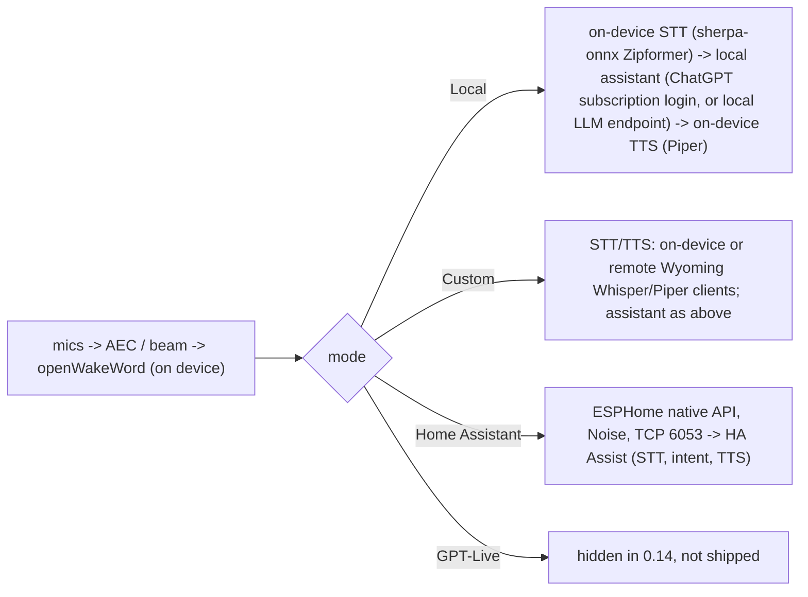

# R-10: LibreEcho as a third Echo Dot 2 base

Date: 2026-11-09 · Feeds: roadmap B0 (base trial), the "Dot base" open question, ADR-0013 (to be proposed after B0) · Refines: [R-08](08-existing-echo-dot-projects.md) section 9, [R-09](09-echo-unlock-history.md)

Method: read-only study on 2026-11-09 of the public LibreEcho repositories through the GitHub API and raw files: `aslater3/LibreEcho` (**LE**), `LibreEcho-UI` (**LE-UI**), `LibreEcho-Platform`, `LibreEcho-Linux`, the release notes and issue trackers, and the Home Assistant forum thread. Nothing was cloned, built, installed or run; no device was touched and no code was copied. Paths are relative to the repository named; base URLs are `https://github.com/aslater3/<repo>`. Claims I could not confirm from a primary file are marked **(unverified)**. The T5D and EM columns of the matrix come from R-08, not from new reading, except where stated. The project says it was built with heavy use of AI tools (forum thread opening post, and `AGENTS.md` and Claude-generated issue text in the repositories), so, as in R-08, I weight code, measured results and release notes over narrative.

## 1. Summary

1. **LibreEcho is a real third option, but it is the youngest.** Created 2026-07-27, MIT, 132 stars, 11 forks, 32 open issues in LE and 114 in LE-UI (GitHub counts pull requests in that number), 19 stable releases plus 132 pre-releases, last push 2026-11-05 (LE) and 2026-11-08 (LE-UI). Its own README says the Dot (`biscuit`) is "newer and less field-tested"; the 0.14.0 note calls Dot support "experimental" and says the Dot "was validated on an earlier 0.14 candidate"; the forum opener (2026-08-16) said it "explicitly does not target the Echo Dot 2".
2. **It is the most complete product of the three and the least like a thin front end.** It replaces Fire OS with its own Linux 6.1 kernel and C99 daemons, and carries its own speech stack (streaming STT, Piper TTS, a local assistant, AirPlay, Sendspin, internet radio, baby monitor, web control centre). That is a strength for a standalone user and a cost for us (more resident software, more payload, more surface to trust).
3. **It does not need Home Assistant.** Local and Custom voice modes work without it (LE `docs/plans/ha-esphome-0.14.md`, LE-UI `docs/HOME_ASSISTANT_VOICE.md`). But its "brain" for those modes is a ChatGPT-subscription provider or a "local LLM endpoint", not a general protocol we can drop ClawDot behind. **(What that endpoint speaks is unverified.)**
4. **Our attach routes exist, in two forms.** (a) The ESPHome native API on TCP 6053 with Noise, written in C99 (`libreecho-esphomed`), advertising voice-assistant feature flags 61, which are `VOICE_ASSISTANT`, `API_AUDIO`, `TIMERS`, `ANNOUNCE` and `START_CONVERSATION` (LE-UI `docs/HOME_ASSISTANT_VOICE.md`). That is exactly the B2 client contract in R-08 section 4.2, and, unlike T5D, ANNOUNCE and START_CONVERSATION are stated in the doc rather than guessed. (b) An authenticated HTTP API with `POST /api/v1/audio/announce {"text": ...}` that speaks through the on-device TTS (LE-UI `docs/API.md`), which is a push path that needs no ESPHome client at all, though it is text only.
5. **Two things block a clean non-HA attach.** The satellite is built to be adopted by HA: the Noise key is provisioned by HA and "there is no web reveal/rotation endpoint" (LE-UI `docs/HOME_ASSISTANT_VOICE.md`), the plan allows "at most two API clients", and whether a second client can hold the voice subscription is **unverified**. A ClawDot client would have to be the first client on the all-zero "unprovisioned" PSK and provision a key itself, or run unprovisioned.
6. **Install is the weak spot for our case.** It flashes **both** boot slots and **formats userdata** (LE `docs/install/README.md` section 3), so the maintainer's rooted Fire OS plus TWRP state is gone after install except from backups. T5D by contrast boots from the recovery partition and leaves Fire OS in the boot slots (R-08 section 3.7 table). LibreEcho documents **no way back to stock Fire OS** (LE issue #295, open). Its installer is Linux-host first (`adb`, `fastboot`, `e2fsprogs`, Python 3); WSL/usbipd is documented as failing mid-install (issue #293), and the browser installer is a preview with an open Dot failure (issue #328, same setup as ours: Dot already unlocked, TWRP 3.7.0_9-0, v0.14.4).
7. **Licences are mixed and one part is a trap.** LE and LE-UI are MIT; the kernel (`LibreEcho-Linux`) and Platform tooling are GPL-2.0-only; the shipped wake-word models are openWakeWord v0.5.1 under **CC-BY-NC-SA-4.0** in a separate noncommercial asset; the Piper voices are CC-BY-SA-4.0; a 30,964-byte audio FPGA bridge firmware ships with `license=NOASSERTION`. For a Rust (Apache-2.0) project that attaches over a network protocol, none of this contaminates us. For anyone who builds on the image it matters (section 6).
8. **Bus factor is about one.** One account (`aslater3`) has 633 of about 650 commits in LE and 851 of about 1,020 in LE-UI; the next human contributor has 168 in LE-UI. Releases and docs are produced at a very high rate, partly by AI tooling, which also means the docs are detailed but not independent evidence (section 7).
9. **No RAM or CPU figures are published** for the Dot or the Echo. Payload sizes are: STT 54 MB, TTS 160 MB, AirPlay 9.5 MB, wake word 8.2 MB, assistant 3.0 MB (squashfs, `biscuit` release assets for 0.14.5). Whether the Dot's 512 MB runs STT, TTS and wake word together with headroom for ClawDot is the main thing B0 must measure if LibreEcho becomes a candidate.
10. **Recommendation: keep T5D first for B0, and add LibreEcho as a second, later trial that does not start before the T5D trial is written up** (section 10). The T5D trial is lower risk on our unit (recovery-partition install, Fire OS left in place), and the open question about `echod` serving a non-HA client is still the deciding unknown. LibreEcho is the better fallback than EchoMuse if `echod` fails, because it has a documented HTTP announce path and ANNOUNCE/START_CONVERSATION flags today.

## 2. What it is

| Item | Evidence |
|---|---|
| Purpose | "A repairable, private voice assistant for hardware you already own." Replaces the Echo's software; web control centre at `libreecho.local:8080`; signed releases (LE `README.md`) |
| Devices | Echo 2nd Gen `radar_puffin` (fastboot product `RADAR`) and Echo Dot 2nd Gen `biscuit` (`BISCUIT`), both MT8163. Candidates, not started: Echo Dot 3, Echo 3, Echo Plus 2, Echo Studio (MT8516 family); MT8183/MT8512 are research (LE `README.md`; LE issues #346, #348) |
| Latest stable | `radar-puffin-v0.14.5`, published 2026-10-30 (LE `CHANGELOG.md`, release list). `0.14.6` checklist is open (LE issue #336) |
| Repositories | LE (site, docs, installer tools, release notes, OTA distribution), `LibreEcho-Platform` (ARM32 tooling, initramfs, feature packaging, OTA inputs), `LibreEcho-Linux` (kernel; the older `LibreEcho-Linux-6.1` is archived in the README's words), `LibreEcho-UI` (control centre, HTTP API, daemons, tests) (LE `docs/repositories.md`). GitHub shows `LibreEcho-Linux-6.1` as still not archived; the README and GitHub disagree, minor |
| Languages | LE-UI and daemons are C99 (`libreecho-web`, `libreecho-esphomed`, `audiod`, `ledd`, `networkd`, `buttond`, `waked`, `micd`, `sttd`, `radiod`, `mdnsd`, `agentd`); installer and tools are Python and shell; the kernel is C (it also carries a `rust/` directory, unused as far as I can tell **(unverified)**) |
| Userland | BusyBox 1.37.0, musl 1.2.5, glibc and GCC runtime (for the AirPlay and Sendspin payloads), wpa_supplicant 2.10, libnl, Mbed TLS 3.6.7, Dropbear for SSH (LE `release/THIRD_PARTY_NOTICES.md`; LE `release/radar-puffin-v0.14.5.md`) |
| Status of the Dot | "experimental"; `biscuit` validated by OTA install, boot and slot confirmation on one physical unit per release; fresh install of 0.14.5 on a physical device is listed under "Not yet tested" (LE `release/radar-puffin-v0.14.0.md`, `v0.14.5.md`) |

## 3. How voice reaches a brain, and whether ClawDot can attach

LibreEcho has four voice modes (LE-UI `docs/API.md` "Voice assistant", `docs/HOME_ASSISTANT_VOICE.md`):

- **Home Assistant is optional.** The 0.14 plan keeps Local and Custom modes and preserves their settings while HA owns voice (LE `docs/plans/ha-esphome-0.14.md`). The Wyoming satellite was removed in 0.14.0 for the ESPHome API; Wyoming survives only as Whisper/Piper **clients** (LE `release/radar-puffin-v0.14.0.md`). This matches R-08: the Dot's integration surface is ESPHome, not Wyoming.
- **ESPHome route (the B2 client).** Everything in R-08 section 4.2 applies. Additional facts from LE-UI `docs/HOME_ASSISTANT_VOICE.md`: native API version 1.14; reviewed against Home Assistant 2026.9.4 and aioesphomeapi 46.2.0; voice flags 61 with the `SPEAKER` bit (2) deliberately omitted, so **TTS comes back as URL playback**, not streamed PCM (that is the easier path for us: the core already serves HTTP); conversation continuation is handled at `INTENT_END`; only post-AEC mono 16-bit 16 kHz PCM is sent upstream with detection-relative pre-roll. The plan adds: a 64 KiB maximum frame, at most two API clients, WAV/MP3 announcements with music ducking, HA-owned remote timers, soft mute that does not override the hardware latch, and Noise with key persistence (LE `docs/plans/ha-esphome-0.14.md`).
- **Noise key handling is the sharp edge.** The key is stored as a 32-byte base64 value, mode 0600, "never revealed" by the API, and an unprovisioned device uses the all-zero PSK until HA provisions it (LE-UI `docs/HOME_ASSISTANT_VOICE.md`). For ClawDot this means: first contact on the zero PSK, send `noise_encryption_set_key`, and store the key ourselves; after that HA cannot adopt the device unless it is given the same key. T5D's key sits in a file we can read **(from R-08; not re-verified)**. This is a trade-off, not a blocker.
- **Single subscriber, no-HA behaviour: unverified.** Nothing I read says whether a second ESPHome client can subscribe while another holds the voice session, or whether a pipeline with no HA connected falls back to Local. The plan says "an installed/listening satellite is not necessarily connected to HA; expose that distinction honestly", which suggests the daemon is designed to run unconnected, but that is not the same as accepting another brain.
- **HTTP route (push without ESPHome).** `POST /api/v1/audio/announce` with `{"text": ...}` speaks through local TTS and the announcement bus; the API doc calls it "the supported path for external local services". `POST /api/v1/audio/announce/stop` interrupts. Auth is a bearer token or a users-file session, plus an `X-LibreEcho-CSRF` header taken from `GET /api/v1/config`, and an Origin check (LE-UI `docs/API.md` "Authentication"). So ClawDot can **push** an inbox announcement without any client protocol, but it cannot supply its own audio or its own voice through this endpoint, and it gets back only `{"speaking": true}` with no completion signal in the response (`GET /api/v1/events` is an SSE snapshot, **unverified whether it signals announcement end**). Listening for the reply still needs either the ESPHome route or Local/Custom mode.
- **Local LLM endpoint route (lowest effort, least understood).** The Integrations page can point the assistant at "a local LLM endpoint and model" (LE `release/radar-puffin-v0.14.0.md`). If that is an OpenAI-compatible chat endpoint, ClawDot could serve it and keep on-device STT and TTS. The request shape, streaming, tools and authentication are **unverified** and need the control-centre or source to settle. The 0.14 API doc lists only the `openai-codex` (ChatGPT subscription device-login) provider by name, and says it "never accepts or falls back to an OpenAI API key" (LE-UI `docs/API.md`).
- **Wake word.** openWakeWord running on the device (the "Alexa" phrase is the default and "compatibility identifier", not an Amazon endorsement, in the notices). Custom wake words, two wake words and server-side wake are **open** issues (LE #331, LE-UI #402, #403, #406). The TECHO5 comparison page lists "custom wake word models" as a LibreEcho gap (section 9).

Verdict on attach: **possible and probably cleaner than EchoMuse, with the same central unknown as T5D** (will it serve a non-HA ESPHome client?). It is also the only one of the three with a documented text-announce HTTP endpoint.

## 4. On-device stack, size and what "debloat" means here

- **Amazon software:** Android is not started. LibreEcho boots its own kernel and initramfs. It does **not** delete Amazon's system image: it "preserves `system_a`, userdata and rollback by default" and, at run time, **imports vendor Wi-Fi and Bluetooth connectivity firmware read-only from the owner's `system_a`** (LE `release/THIRD_PARTY_NOTICES.md`, "Owner-device connectivity firmware"). So the Dot needs its stock system partition intact to get radio firmware. Setup shows "Unrecognised Wi-Fi firmware detected / Accept device firmware" (LE `docs/install/README.md` section 5).
- **What runs:** the daemons above, mDNS (Avahi/D-Bus shared runtime since 0.14.0), Dropbear SSH (on by default unless switched off, 0.14.5 note), the web server, an OTA agent. Optional **payloads** are SquashFS images installed per feature: AirPlay 2 (Shairport Sync 5.6.2, NQPTP, FFmpeg 6.1.6), STT, TTS, wake word, assistant. Biscuit 0.14.5 sizes: STT 54,263,808 bytes, TTS 160,206,848, AirPlay 9,531,392, wake word 8,200,192, assistant 3,022,848 (release assets of `radar-puffin-v0.14.5`). Core image size and boot time are not published **(unverified)**.
- **Memory:** no RSS, free-memory or CPU figures for either model are in the release notes, API doc, ARCHITECTURE or forum thread. T5D reports 445 of 481 MB free and an 18.7 MB `echod` binary (R-08). Sherpa-onnx streaming STT and Piper TTS are the obvious large residents; whether they are loaded at all times is **unverified**. B0 must measure.
- **Filesystem budget:** a full OTA needs about 230 MB free in `/data` (0.14.5 note), which is large next to the Dot's userdata, and was the cause of repeated "generation-space" update failures fixed in 0.14.5.
- **Local services:** `/data/libreecho/local/services` survives A/B updates and can start your own programs after boot (0.14.5), so ClawDot could run on the Dot as a "local service", at low priority, and is skipped if the device failed three boots in a row. This is the closest match to the B5 co-resident idea. The switch is on the System page, or create `/data/libreecho/local/enabled` over USB ADB.

## 5. LEDs, buttons, mute, Wi-Fi, Bluetooth, updates

- **LEDs:** 12-pixel IS31FL3236 ring through `ledd`; `GET/PUT /api/v1/led` exposes colour, brightness, visualizer state, per-state profiles (`listening`, `thinking`, `error`, `dnd`), and the 0.14 batch adds states for voice, Bluetooth pairing, announcements, playback and a sleep light (LE-UI `docs/API.md` "LED"). Idle ring defaults to a dim green front indicator; "idle light auto-off" arrived in 0.14.5. **Not exposed to ESPHome yet** (LE-UI #395, open). So a ClawDot `inbox` state is reachable over HTTP, not over the satellite API.
- **Buttons:** `libreecho-buttond` reads evdev; all four buttons are wired with press feedback and settings (0.14.0 note). `GET /api/v1/buttons` reports capability and privacy-latch state. The Action button's "Start listening" and "Play/pause" are **not implemented** (LE-UI #372, open); button presses are not sent to HA as events yet (LE-UI #394, open).
- **Mute:** the hardware mute button owns a kernel privacy latch that lights the lamp; software cannot assert or release it. A software mute lights the ring and, where the kernel exposes the lamp control, the lamp. Soft mute is reflected in ESPHome without overriding the latch (LE-UI `docs/API.md` "Buttons"; plan "Soft mute"). This is the same hazard R-07 and R-08 record for `amz_privacy`.
- **Wi-Fi:** wpa_supplicant 2.10 with nl80211 preferred; **first-run setup happens over the installer's USB/ADB port forward** to `http://127.0.0.1:18080/setup.html`, then the device is reachable at `libreecho.local:8080`. Setup over a temporary access point is an open request (LE #313). That means a PC with USB attached and a browser on the same host are required for the first boot. Wi-Fi credentials are stored on the device and are removed by factory reset.
- **Bluetooth:** phone-to-speaker (A2DP sink) with AVRCP absolute volume since 0.14.3, and a fix for crackle. **Playing out to a Bluetooth speaker (A2DP source) is not implemented** (LE-UI #411, open). The API doc still says the production image reports `profile_state: "pairing-only"` (LE-UI `docs/API.md`), which conflicts with the 0.14.3 release note; I treat the release note as newer and the doc as stale, **(unverified on a device)**. A bug in SBC parsing is open (LE-UI #484). No Bluetooth proxy (LE-UI #441, open).
- **Updates:** signed OTA v3: each update is a complete signed generation (boot image plus every payload); the previous generation stays until the new one boots and confirms; fetched from `dl.libreecho.org` with GitHub as fallback; automatic installs opt-in (0.14.0 and README). 0.13 devices cannot take 0.14 OTA and must reinstall, which erased userdata. Update failure causes (space, quarantine) were fixed only in 0.14.5, and "an update started from the web UI" and "a forced rollback from 0.14.5" are listed as not yet tested on a physical device.
- **Telemetry and privacy:** a weekly anonymous ping to `stats.libreecho.org` is **on by default**, off-switch only from 0.14.5; "health and crash" consent boxes record consent but send nothing in 0.14 (LE `docs/privacy.md`). An optional news fetch is off by default. This is declared and small, but it is outbound traffic by default from a device that would carry ClawDot's agent inbox. Our docs would have to tell users to switch it off.

## 6. Licences

| Part | Licence | Evidence | Meaning for us |
|---|---|---|---|
| LE, LE-UI, LE-Docs | MIT | GitHub licence field; `LICENSE` | Free to read and cite. We copy nothing |
| `LibreEcho-Linux` (kernel, MT8163 drivers) | GPL-2.0-only | LE `release/THIRD_PARTY_NOTICES.md`; GitHub shows `NOASSERTION` because of the kernel tree layout | Corresponding source is published; never mix into our Apache-2.0 tree |
| `LibreEcho-Platform` (initramfs tooling) | GPL-2.0-only | Same notices; GitHub shows `NOASSERTION`; the repository has a kernel-shaped top level | As above |
| Wake-word models (openWakeWord v0.5.1) | CC-BY-NC-SA-4.0, separate asset only for `community-noncommercial` scope | Same notices; LE README says "noncommercial wake-word model" | **Same finding as R-08 and R-03.** We do not bundle it, and the LibreEcho default wake word is not available to a commercial or redistributed ClawDot image |
| Piper voices `en_GB-northern_english_male-medium`, `en_GB-southern_english_female-low` | CC-BY-SA-4.0 (OpenSLR SLR83) | Same notices | Share-alike if we ever ship them; we do not |
| `i2s_to_spi_v34.bin` audio FPGA firmware (30,964 bytes) | `NOASSERTION`, accepted by the project as a documented good-faith exception | `release/FPGA-PROVENANCE.md`; notices | A redistribution risk for anyone shipping the image. Not ours, but an argument against us **bundling or redistributing** LibreEcho images |
| Vendor Wi-Fi/BT firmware | Amazon's, read from the owner's `system_a` at run time, not redistributed | Notices | Good practice, matches our rule |
| Unlock (Amonet, Kaeru) | Upstream licences; archive supplied by the owner, not redistributed | Notices, install guide | Same as R-08 section 6 |
| Sendspin SDK, mbedTLS, BusyBox, etc. | Apache-2.0, GPL-2.0, BSD, MIT as listed | Notices | Not relevant to us unless we ship an image |

Rule that follows (same as R-08): install guides link to the project's own release; ClawDot never redistributes a LibreEcho or T5D image.

## 7. Install risk, recovery, community and bus factor

**Install procedure (Dot).** Linux host with `adb`, `fastboot`, `e2fsprogs`, Python 3, `curl`; one data micro-USB cable; hold **Action** on a stock Dot or **Volume Down** on an already-unlocked (Kaeru) Dot while plugging in USB; `run-one-shot.sh latest --fastboot-serial auto --slots both --execute-hardware`. The installer verifies the installer checksum, reads the fastboot product, runs Amonet only if the device is locked (the owner supplies `amonet-biscuit-v2.0.0.zip`; any non-empty `lk_build_desc` is accepted), formats userdata, writes and verifies both boot slots, and does not erase `expdb`. State is kept in a state file, with `--continue` and `--reinstall` (which asks for `ERASE`) (LE `docs/install/README.md`).

**What can go wrong, with evidence:**

| Event | Evidence | Lesson |
|---|---|---|
| Dot, already unlocked, TWRP 3.7.0_9-0, v0.14.4 browser installer: every retry stops at "prepare phase already attempted"; page offers no way to classify and resume | LE issue #328, open | This is **our unit's state**. The CLI path may behave differently **(unverified)**, but the browser installer, which is the path for a Windows machine, is the one that failed |
| Echo 2nd Gen on the old boot chain: the migration kit finishes (`ALLDONE`, all readbacks OK), then the unit loops in USBDL with "Failed to load LK"; recovery needed BROM access (Mute plus barrel power) and rewriting `expdb` and `misc` by hand | LE issue #325 (closed, recovered by the reporter on 2026-10-31) | Unlock-chain changes brick-class failures even when the tool reports success; recovery needs a PC and the maintainer's help. This is the Echo, not the Dot, and a different chain |
| WSL2 with usbipd loses ADB after first boot; install image is fine, resume with `--continue` | LE issue #293, install guide "Windows with WSL" | The maintainer's host is Windows 11. "A native Linux host is the tested setup" |
| `--fastboot-serial auto` counted fastboot's trailing newline as a second device; userdata size mismatches on the Dot and Echo | LE #320, #230, #303 (all closed) | Early installer bugs, since fixed; shows how new it is |
| No restore-to-stock path | LE #295, open | Not available. The notices say `system_a` is preserved, so a way back probably exists in principle **(unverified)** |
| First-run setup depends on the USB/ADB forward and a PC | install guide section 5 | Setup cannot be done from a phone yet (LE #313 open) |

**Recovery.** There is a "Recovery and reflash" panel that reboots into recovery without opening the case (0.14.5), a Kaeru fastboot key combination (Volume Down), a TWRP hand-off, and signed rollback slots for OTA. For a hard brick the Dot has no case-free recovery documented; R-08 section 3.8 records that the Amonet-class recovery is "open the case and short a test point". The install guide says only: "Stop and keep the installer log if the device behaves unexpectedly."

**Activity and community.** LE: created 2026-07-27, 633 commits by `aslater3`, then 3, 3, 2, 1, 1, 1; LE-UI: 851 by `aslater3`, 168 by `itpick`; Platform: 799 by `aslater3`, plus upstream kernel names (the tree is a kernel fork). 132 stars, 11 forks, a Discord, a GitHub Discussions tab, a forum thread of 8 replies (last 2026-10-13). Release cadence: 0.14.0 through 0.14.5 within October 2026, with `0.13.8` to `0.13.20` from September. Security advisories exist (`SECURITY-ADVISORIES.md`) and the 0.14.5 release patched remotely reachable Shairport Sync bugs, which is a good sign about monitoring and a reminder that a fat image has CVE surface.

**Bus factor.** About one maintainer for firmware, installer, kernel and UI. `itpick` is the visible second contributor and tester. Many issues and docs are Claude-generated. This is not disqualifying, but a single person's pace is both the strength (daily fixes) and the risk (project stalls, or a reinstall-only upgrade such as 0.13 to 0.14 breaks the installed base). For comparison, from R-08: EM has 30+ contributors and 1,429 stars; T5D has 5 contributors and 238 stars, with `echod` from EchoLocal (549 stars).

## 8. Overlap with the T5D comparison page

`HuskerMinion/techo5/docs/comparison.md` (checked 2026-11-08) has a LibreEcho section. It is written by the TECHO5 author and says so, so treat the rows as a competitor's reading. Its rows agree with what I found where they overlap (Dot 2 "experimental", phone-to-speaker Bluetooth yes, play-out-to-speaker not found, works without HA yes, custom wake words and two wake words no). LibreEcho's own tracking issue #297 ("feature gaps from the TECHO5 project comparison") accepts the same list, which is independent confirmation. The comparison page is a useful checklist; it is not a neutral source.

## 9. Decision matrix

Legend: **+** good for us, **-** bad for us, **0** neutral, **?** unknown, to be measured in B0. T5D and EM cells are from R-08 and were not re-read.

| Need | TECHO5 Dot (T5D) | EchoMuse (EM) | LibreEcho (LE) |
|---|---|---|---|
| Non-HA brain attach | **?** `echod` serves the ESPHome API on 6053 with Noise; single-subscriber and no-HA behaviour unverified; setup page opens only from HA (issue #40) | **-/0** per-device plaintext ESPHome port on a Python controller; needs the controller and a dashboard approval | **?** same ESPHome API (flags 61); Noise key not revealable; max two clients; unprovisioned zero-PSK first contact possible; plus Local/Custom modes that do not need HA |
| Push / announce | **?** `VoiceAssistantAnnounceRequest` claimed, unverified in code | **+** implemented in the controller (announce and announce-then-listen) | **+/?** ANNOUNCE and START_CONVERSATION advertised; **plus an HTTP `POST /api/v1/audio/announce` (text only, token and CSRF)** |
| Dot 2 maturity | **+** "in daily use on three units"; Dot 2 tested on a bench unit; roughly daily releases | **+** daily fleet use; emOS has "fewer device-hours" than Fire OS | **-** "experimental", "less field-tested"; Dot added in 0.14.0; one open Dot installer failure (#328) |
| Debloat: what runs, sizes | **+** Alpine armv7 rootfs about 49 MB; one Go daemon (`echod`, 18.7 MB); 445 of 481 MB free (own numbers) | **0** Android stack replaced by static PID 1 plus bionic from the device's own `/system`; Python controller off-box | **-/?** many C daemons and optional payloads (STT 54 MB, TTS 160 MB squashfs); no RAM figure published; local STT/TTS may be unwanted if ClawDot supplies both |
| Install risk and recovery | **+** installer starts from unlocked Fire OS, boots from recovery partition, leaves Fire OS in boot slots, escrow backups, rescue mode | **0** escrow backups, `dd` restore in about 10 s; same unlock risk; FireOS 5 path or emOS | **-** writes both boot slots and formats userdata; no restore-to-stock guide (#295); Linux host first; browser installer failing on an unlocked+TWRP Dot (#328); one Echo near-brick (#325) |
| Update model | **+** signed A/B root slots with trial boots and rollback; daily releases | **0** A/B via boot image copy and counter | **+** signed OTA v3 generations with rollback; opt-in auto; but 0.13 to 0.14 needed reinstall and 0.14.5 fixed update space bugs; rollback untested on device |
| Bluetooth speaker mode | **0** partial (per the T5D author's comparison page, not R-08: phone-to-speaker "partly", play-out and proxy yes) | **?** not studied; BLE proxy exists | **+/-** phone-to-speaker with AVRCP absolute volume works; play-out to speaker not implemented (#411) |
| LED / button / mute access | **0** ring as a configuration entity; mute via entity (unverified) | **+** documented LED `frame` format and serialised writers | **+/-** full HTTP API for LED (profiles per state), buttons and mute lamp; **not yet exposed to ESPHome** (#394, #395); Action button actions open (#372) |
| Licences | **+** MIT; kernel GPL source published | **+** MIT; ships no image | **0** MIT UI; GPL-2.0 kernel and tooling; wake-word models CC-BY-NC-SA-4.0; one unlicensed firmware blob; Piper CC-BY-SA |
| Community / activity | **0** 238 stars (T5 600), 5 contributors, daily releases | **+** 1,429 stars, 30+ contributors, 154 open issues | **0** 132 stars, 11 forks, 8-reply forum thread, one very active author, many issues |
| Bus factor | **-** small team | **+** largest | **-** about one person (633 of about 650 commits), partly AI-driven |
| Fit with Rust brain over a network protocol | **+** one-hop ESPHome server on the Dot; co-resident ClawDot dialling 127.0.0.1:6053 | **0** two hops; Python controller | **+/?** same ESPHome contract plus HTTP; "local services" lets ClawDot run on the Dot; heavier image beside it |
| Privacy defaults | **?** | **?** | **-** weekly ping on by default until 0.14.5 switch; SSH on by default |

## 10. Recommendation

1. **Keep T5D first.** Nothing here changes the B0 plan: T5D leaves Fire OS in the boot slots, is more mature on this exact device, and the key unknown (does `echod` accept a non-HA ESPHome client?) is still to be measured. A failed T5D trial is cheaper to undo than a failed LibreEcho install, which also formats userdata.
2. **Make LibreEcho the documented second base and the fallback to EchoMuse.** If the T5D trial says `echod` cannot serve a non-HA client, test LibreEcho before building the EchoMuse controller route, because it already advertises ANNOUNCE and START_CONVERSATION, can run unattached to HA, and has an HTTP announce endpoint. Update the matrix in [open-questions.md](../open-questions.md) when the maintainer decides; this note does not change the roadmap or open questions.
3. **Do not plan around its stack.** ClawDot should treat LibreEcho (like T5D) as a front end reached over ESPHome and HTTP. Do not depend on the Local STT/TTS payloads, the ChatGPT-subscription assistant, the CC-BY-NC-SA wake-word models or the telemetry.
4. **Do not trial it on the maintainer's only Dot without a second, written rollback.** The install overwrites both boot slots and userdata. Before any write: full partition backups verified as in R-08 3.8, the CLI (not browser) installer on a native Linux host, `--dry-run` where the tools offer it, and an agreed restore path to the rooted Fire OS plus TWRP state. No LibreEcho restore-to-stock procedure exists to rely on (#295). Every write still needs the maintainer's explicit go.
5. **Watch these upstream items** (open at the time of reading) as a re-evaluation trigger: LE-UI #394/#395/#397 (ESPHome button events, LED ring light and announce actions), #372 (Action button), #411 (Bluetooth play-out), LE #331 and LE-UI #402 (custom wake words), LE #295 (way back to stock), LE #313 (setup without a PC), LE-UI #408 (nearest device answers), #328 (Dot installer on unlocked units).

### 10.1 What B0 must additionally measure if LibreEcho is a candidate

Everything B0 already measures for T5D (idle RSS, CPU, boot time, non-HA client, Noise key handling, rollback), plus:

1. **Install on our unit's state.** Does `run-one-shot.sh` treat a Dot unlocked by our route (rooted Fire OS plus TWRP) as unlocked, skip the unlock stage, and succeed? Which unlock chain is on the unit (the open question "how was it unlocked")? What does `fastboot getvar product`, `lk_build_desc` and `oem kaeru-version` report? Does it complete without the browser installer?
2. **Backups and the way back.** Which partitions does the installer change (both boot slots, userdata, `misc`, `expdb`, recovery)? Restore the escrow set and prove the unit returns to rooted Fire OS with TWRP. Record the time and the tools needed.
3. **Memory and CPU.** `MemFree`, `MemAvailable`, per-daemon RSS (`web`, `esphomed`, `audiod`, `waked`, `micd`, `sttd`, `agentd`, `radiod`, `mdnsd`) idle and during a voice turn, with each payload on and off (STT, TTS, AirPlay, wake word, assistant). Does ClawDot's 64 MB budget fit beside them? Is local STT/TTS loaded when HA mode is selected?
4. **Disk.** Free space on `/data` after install and after one OTA (an OTA needs about 230 MB); size of the installed generations.
5. **Non-HA attach.** Can a second client connect to 6053 while no HA exists? First contact on the zero PSK, `noise_encryption_set_key`, reconnect with the key, and what happens when HA later tries to adopt. Can ClawDot hold `SubscribeVoiceAssistant` with `API_AUDIO`, receive wake and audio, return TTS as a URL, and use `VoiceAssistantAnnounceRequest` with `start_conversation`? Does `ANNOUNCE_FINISHED` fire at real end of playback? What if a turn is already running?
6. **HTTP announce.** With the bearer token and CSRF header, does `POST /api/v1/audio/announce` speak with no HA and no cloud? Latency to first audio (the doc quotes a 3000 ms target), whether SSE signals completion, and whether a longer text or a media URL path exists.
7. **Local LLM endpoint contract.** What protocol and fields the "local LLM endpoint" setting expects, and whether ClawDot can stand in for it.
8. **Telemetry and network.** Capture of all outbound destinations in a day of idle and of use, with the ping switched off (`stats.libreecho.org`, `dl.libreecho.org`, GitHub). Inbound ports listening (web 8080, SSH, 6053, mDNS) and whether the default firewall (Platform #286, closed) blocks a ClawDot listener on 3335.
9. **Buttons, LED, mute.** Latency from ClawDot to ring change over HTTP; whether LED state set over HTTP survives a voice turn; mute button behaviour, latch versus soft mute, on this Dot; which button events reach a client.
10. **Bluetooth.** Pairing from a phone, A2DP sink latency and dropouts on the Dot (not only the Echo), and AVRCP volume.
11. **Update and rollback.** One OTA forward and one forced rollback, both listed as untested on a physical device in the 0.14.5 note.
12. **Stability.** A 24-hour soak (memory growth, `agentd` duplicate processes as in LE #344, mDNS loss as in LE-UI #458 and Platform #308) with a repeated announce-then-listen loop.

## 11. Unverified or risky points

- Whether the ESPHome satellite accepts a non-HA client, and how many voice subscribers it supports. Central.
- The shape of the "local LLM endpoint" and whether it fits ClawDot.
- RAM, CPU, boot time and disk figures for the Dot. None are published.
- Whether the installer's CLI path works on a Dot unlocked and rooted through another route (issue #328 describes only the browser path).
- A way back to stock Fire OS (#295) and whether `system_a` is genuinely untouched.
- Bluetooth profile status on the Dot (conflict between the API doc and the 0.14.3 note).
- Whether announcements complete signals reach an HTTP caller.
- I read documentation and trackers only; I did not read daemon source, release binaries or build anything. The GitHub contributor counts for Platform include upstream kernel authors and are not a measure of the project's own team.
- Counts of stars, issues and commits are a snapshot of 2026-11-09 and move daily.

## Confidence

Project facts (devices, licences, install steps, release notes, issue contents, API shape and voice flags) read from primary files: **high**. The matrix cells for T5D and EM are carried over from R-08 at **medium-high**. Fit with ClawDot over ESPHome and HTTP, install risk on our unit, memory fit on 512 MB and the ranking against T5D: **medium to low**; they are the subject of B0 and cannot be settled without the maintainer's go on a device.

## Sources

- `https://github.com/aslater3/LibreEcho` (`README.md`, `CHANGELOG.md`, `docs/install/README.md`, `docs/privacy.md`, `docs/plans/ha-esphome-0.14.md`, `docs/repositories.md`, `release/THIRD_PARTY_NOTICES.md`, `release/radar-puffin-v0.14.0.md`, `v0.14.3.md`, `v0.14.5.md`, issues #230, #293, #295, #297, #313, #320, #325, #328, #331, #336, #344, #346)
- `https://github.com/aslater3/LibreEcho-UI` (`docs/API.md`, `docs/HOME_ASSISTANT_VOICE.md`, `docs/ARCHITECTURE.md`; issues #372, #394, #395, #397, #402, #403, #406, #408, #411, #441, #458, #484)
- `https://github.com/aslater3/LibreEcho-Platform` (issues #283, #286, #308), `https://github.com/aslater3/LibreEcho-Linux`
- `https://community.home-assistant.io/t/libreecho-replacing-amazons-software-on-the-full-size-echo-gen-2-with-linux-6-1/1021372` (opened 2026-08-16, 8 replies)
- `https://github.com/HuskerMinion/techo5/blob/main/docs/comparison.md` (checked by its author 2026-11-08; partly read)
- `https://libreecho.org` was not fetched.
